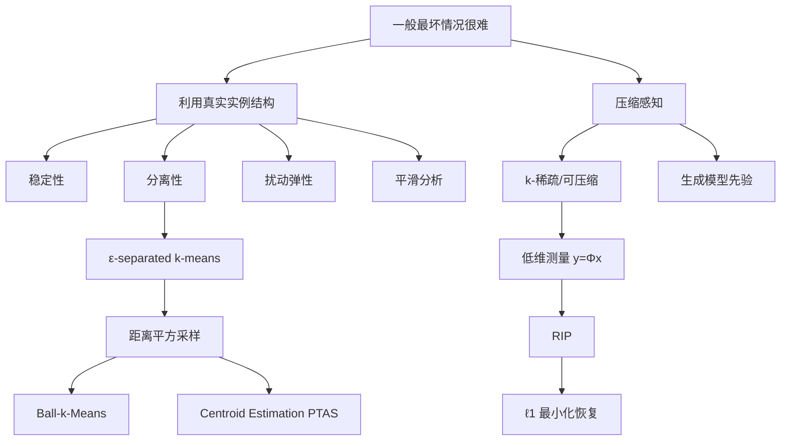
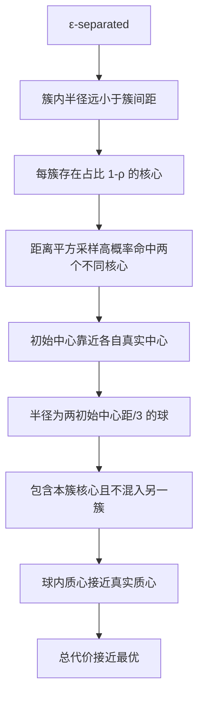
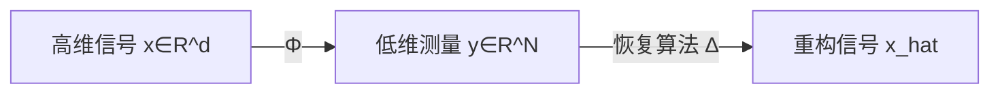

# 第十章 Beyond Worst-Case Analysis 与压缩感知

> [!abstract] 本章主线
> 本章包含两条相对独立的主线：
> 
> 1. **Beyond Worst-Case Analysis（BWCA）：**在真实实例具有稳定、分离等良好结构时，给出比最坏情况更强的算法保证；
> 2. **Compressed Sensing（CS）：**利用信号稀疏性，以远少于原维度的线性测量恢复高维信号。
> 
> 两者共同体现一种思想：**利用输入的结构，突破一般最坏情况的限制。**

## 本章学习目标

1. 解释最坏情况、平均情况、平滑分析和结构化实例分析的区别；
2. 理解 $\varepsilon$-separated $k$-means 假设；
3. 掌握平方距离的均值恒等式和簇间方差分解；
4. 理解 2-means 的距离平方采样与 Ball-$k$-Means；
5. 说明分离性如何保证采样命中不同簇核心；
6. 了解一般 $k$-means 的 Ball-$k$-Means 与 centroid estimation PTAS；
7. 掌握压缩感知的测量模型、稀疏性、RIP 和 $\ell_1$ 恢复；
8. 正确陈述精确稀疏与近似稀疏的恢复保证；
9. 理解生成模型先验如何替代传统稀疏先验。

## 知识结构图

---

# 第一部分：Beyond Worst-Case Analysis

## 10.1 为什么要超越最坏情况

最坏情况分析提供无条件保证，但它允许输入被对手精心构造。许多实际数据并非这种极端实例。

例如：

- $k$-means 在一般情形下计算困难；
- Lloyd 算法可能陷入局部最优，甚至存在极慢收敛实例；
- 但它在许多真实数据集上非常有效。

BWCA 的问题不是放弃严谨性，而是明确写出更符合现实的结构假设，然后在该假设下证明更强结果。

### 10.1.1 典型模型

| 模型   | 核心假设             | 分析目标        |
| ---- | ---------------- | ----------- |
| 稳定性  | 最优解对目标或输入的小扰动不敏感 | 稳定实例是否容易求解  |
| 分离性  | 簇间距离显著大于簇内尺度     | 启发式能否正确识别簇  |
| 扰动弹性 | 所有允许比例扰动后最优聚类不变  | 鲁棒地恢复唯一结构   |
| 平滑分析 | 对任意输入加入小随机噪声     | 分析扰动后的期望复杂度 |

> [!important] 与平均情况的区别
> 平均情况必须指定完整输入分布；BWCA 可以只假设某种可验证或有意义的结构，而不必假设数据来自完全已知的随机模型。

---

## 10.2 $\varepsilon$-Separated $k$-means

设 $X\subset\mathbb R^d$，定义最优 $k$-means 代价

$$
\Delta_k^2(X)
=
\min_{|C|=k}
\sum_{x\in X}d(x,C)^2.
$$

> [!definition] $\varepsilon$-separated
> 若
> $$
> \Delta_k^2(X)
> \le
> \varepsilon^2\Delta_{k-1}^2(X),
> $$
> 则称 $X$ 是 $\varepsilon$-separated。

含义：从 $k-1$ 个中心增加到 $k$ 个中心后，最优代价出现数量级下降。说明数据确实包含 $k$ 个明显簇，而不是把一个模糊云团勉强切成 $k$ 份。

$\varepsilon$ 越小，分离越强。

---

## 10.3 均值与平方距离的两个核心恒等式

### 10.3.1 单簇均值恒等式

令

$$
\mu(X)=\frac1n\sum_{y\in X}y,
\qquad
\Delta_1^2(X)=\sum_{y\in X}\|y-\mu(X)\|_2^2.
$$

对任意点 $x\in\mathbb R^d$：

$$
\boxed{
\sum_{y\in X}\|y-x\|_2^2
=
\Delta_1^2(X)+n\|x-\mu(X)\|_2^2
}
$$

#### 详细证明

写成

$$
y-x=(y-\mu)+(\mu-x).
$$

展开平方：

$$
\|y-x\|^2
=
\|y-\mu\|^2
+
\|x-\mu\|^2
+2\langle y-\mu,\mu-x\rangle.
$$

对 $y\in X$ 求和。由于

$$
\sum_{y\in X}(y-\mu)=0,
$$

交叉项消失，得到结论。

> [!warning] 讲义量词勘误
> 讲义在公式前写“$\forall x\in X$”，其实恒等式对任意 $x\in\mathbb R^d$ 都成立。

### 10.3.2 两两距离和

再对 $x\in X$ 求和：

$$
\sum_{x\in X}\sum_{y\in X}\|x-y\|^2
=2n\Delta_1^2(X).
$$

这使得按点对平方距离采样可以在 $O(nd)$ 预处理后实现，而无需显式枚举 $O(n^2)$ 个点对。

### 10.3.3 两簇方差分解

若 $X=X_1\uplus X_2$，$n_i=|X_i|$，$n=n_1+n_2$，则

$$
\boxed{
\Delta_1^2(X)
=
\Delta_1^2(X_1)
+
\Delta_1^2(X_2)
+
\frac{n_1n_2}{n}
\|\mu_1-\mu_2\|^2
}
$$

其中 $\mu_i=\mu(X_i)$。

最后一项是簇间离散度。若 2-means 代价很小，而 1-means 代价很大，则差异主要来自两个簇中心相距很远。

另一个常用结论是：若 $S_1\subseteq S$，$|S_1|=n_1$，$|S\setminus S_1|=n_2$，则

$$
\|\mu(S_1)-\mu(S)\|^2
\le
\frac{\Delta_1^2(S)}{|S|}
\frac{n_2}{n_1}.
$$

它说明：若删除的比例小，剩余子集的质心不会偏移太多。

---

## 10.4 2-means 的结构化算法

设最优两簇为 $X_1,X_2$，中心为 $\mu_1,\mu_2$，满足

$$
\Delta_2^2(X)
\le\varepsilon^2\Delta_1^2(X).
$$

### 10.4.1 步骤一：按平方距离采样点对

从点对 $(x,y)$ 中按

$$
\Pr[(x,y)]
=
\frac{\|x-y\|^2}
{\sum_{u,v\in X}\|u-v\|^2}
$$

采样，得到初始中心 $\hat\mu_1,\hat\mu_2$。

远距离点对概率更高，因此在两个簇明显分离时，很可能一端来自 $X_1$，另一端来自 $X_2$。

### 10.4.2 如何在线性时间采样

先采第一个点 $x$，概率正比于

$$
\sum_{y\in X}\|x-y\|^2
=
\Delta_1^2(X)+n\|x-\mu(X)\|^2.
$$

再给定 $x$，按 $\|x-y\|^2$ 采第二点 $y$。两个阶段各扫描数据一次，因此为 $O(nd)$，而非 $O(n^2d)$。

### 10.4.3 步骤二：Ball-2-Means

令

$$
r=\frac{\|\hat\mu_1-\hat\mu_2\|}{3}.
$$

对 $i=1,2$，取球

$$
B_i=\{x\in X:\|x-\hat\mu_i\|\le r\},
$$

返回球内点的质心 $\bar\mu_i$。

### 10.4.4 “簇核心”的作用

定义簇均方半径

$$
r_i^2=\frac{\Delta_1^2(X_i)}{n_i}.
$$

强分离可推出

$$
r_i^2
=O(\varepsilon^2)\|\mu_1-\mu_2\|^2.
$$

也就是说，簇内半径远小于簇间距离。

定义核心

$$
X_i^{\mathrm{core}}
=
\left\{
x\in X_i:
\|x-\mu_i\|^2\le\frac{r_i^2}{\rho}
\right\}.
$$

由 Markov 不等式：

$$
|X_i^{\mathrm{core}}|
\ge(1-\rho)n_i.
$$

因此每个簇的大多数点都靠近其真实中心。

### 10.4.5 正确性证明链条

讲义给出的结果为：令

$$
\rho=\frac{100\varepsilon^2}{1-\varepsilon^2},
$$

在 $\varepsilon$ 足够小时，算法以至少 $1-O(\rho)$ 的概率返回代价不超过

$$
\frac{1}{1-\rho}\Delta_2^2(X)
$$

的解，运行时间为 $O(nd)$。

#### 关键一步：为什么球内质心接近真实质心

若

$$
X_i^{\mathrm{core}}
\subseteq B_i
\subseteq X_i,
$$

则 $B_i$ 至少包含 $(1-\rho)n_i$ 个本簇点，只删除至多 $\rho n_i$ 个点。利用子集质心偏移界：

$$
\|\bar\mu_i-\mu_i\|^2
\le\frac{\rho}{1-\rho}r_i^2.
$$

因此以 $\bar\mu_i$ 替代最优中心造成的附加代价为

$$
n_i\|\bar\mu_i-\mu_i\|^2
\le
\frac{\rho}{1-\rho}\Delta_1^2(X_i).
$$

对两个簇求和：

$$
\sum_i\left[
\Delta_1^2(X_i)+n_i\|\bar\mu_i-\mu_i\|^2
\right]
\le
\frac{1}{1-\rho}\Delta_2^2(X).
$$

---

## 10.5 一般 $k$-means

### 10.5.1 $D^2$ 式采样

先按点对距离选择两个中心；之后若已有 $i$ 个中心 $\hat c_1,\dots,\hat c_i$，按

$$
D(x)^2=
\min_{j\le i}\|x-\hat c_j\|^2
$$

成比例采下一个中心。这与 $k$-means++ 的核心采样思想一致：离现有中心远的点更可能代表尚未覆盖的簇。

### 10.5.2 Ball-$k$-Means

对每个初始中心 $\hat c_i$，令 $\hat d_i$ 为它到最近其他初始中心的距离，取半径 $\hat d_i/3$ 的球，返回球内质心。

讲义给出：在强分离且 $\varepsilon$ 足够小时，算法以高概率获得近似因子

$$
\frac{1-\varepsilon^2}{1-37\varepsilon^2}
=1+O(\varepsilon^2),
$$

运行时间

$$
O(nkd+k^3d).
$$

### 10.5.3 Centroid Estimation PTAS

仅取球内所有点的质心可能仍受边界点影响。Centroid Estimation 为每个扩展 Voronoi 区域随机采样，并枚举小子集的质心作为候选。

核心事实：若从某簇均匀采到足够多点，小样本均值以常数概率接近真实质心。因此枚举候选并选全局代价最小组合，可获得 $(1+\omega)$-近似。

讲义给出的运行时间尺度为

$$
O\!\left(
2^{O(k(1+\varepsilon^2)/\omega)}nd
\right).
$$

对固定 $k,\omega$ 是多项式时间，但对 $k/\omega$ 指数依赖。

### 10.5.4 其他 BWCA 方向

- **$\beta$-separated clustering：**簇间距离是簇内尺度的 $\beta$ 倍；
- **Spectral separability：**使用谱范数或奇异向量刻画簇结构；
- **Perturbation resilience：**允许范围内扰动距离，最优聚类仍不变；
- **Approximation stability：**所有近似最优解都与目标聚类接近；
- **Smoothed analysis：**对输入加小随机噪声后分析期望运行时间。

> [!important] 假设越强，结论越强
> BWCA 的理论保证只对满足假设的实例成立。使用时必须说明：假设是否可解释、是否可检验、真实数据是否合理满足，而不能把条件结论当成无条件保证。

---

# 第二部分：压缩感知

## 10.6 问题背景

传统采样理论关注带限信号，但很多自然信号在适当基或字典下具有稀疏表示。例如：

- 图像在小波域近似稀疏；
- 音频在频域或时频域稀疏；
- 医学成像可在变换域压缩。

压缩感知希望直接获取少量线性测量，而不是先完整采样再压缩。

---

## 10.7 Encoder–Decoder 与测量模型

信号

$$
x\in\mathbb R^d
$$

通过测量矩阵

$$
\Phi\in\mathbb R^{N\times d},
\qquad N\ll d,
$$

得到

$$
y=\Phi x.
$$

有噪声时：

$$
y=\Phi x+e,
\qquad \|e\|_2\le\eta.
$$

- Encoder：$x\mapsto y=\Phi x$；
- Decoder：$y\mapsto\hat x=\Delta(y)$。

> [!warning] 讲义优化目标勘误
> 若不限制 $x$，当 $N<d$ 时 $\Phi$ 必有非零零空间，不可能对所有 $x\in\mathbb R^d$ 准确恢复。因此不能直接最小化
> $$
> \max_{x\in\mathbb R^d}\|\Delta(\Phi x)-x\|.
> $$
> 必须把 $x$ 限制在某个结构化信号类，如 $k$-稀疏向量、可压缩向量或生成模型的值域。

---

## 10.8 稀疏性与可压缩性

### 10.8.1 $k$-稀疏

$$
\|x\|_0
=|\{i:x_i\ne0\}|
\le k.
$$

$\|x\|_0$ 不是严格范数，但用于计数非零元素。

### 10.8.2 可压缩信号

真实信号往往不是精确稀疏，而是排序后的系数快速衰减。定义最佳 $k$ 项 $\ell_1$ 逼近误差：

$$
\sigma_k(x)_1
=
\min_{\|z\|_0\le k}\|x-z\|_1.
$$

若 $x$ 精确 $k$-稀疏，则 $\sigma_k(x)_1=0$。

---

## 10.9 为什么直接最小化 $\ell_0$ 困难

理想恢复是

$$
\min_z\|z\|_0
\quad\text{s.t.}\quad
\Phi z=y.
$$

这是组合优化，一般计算困难。压缩感知的关键发现是：在合适测量矩阵下，可用凸问题

$$
\min_z\|z\|_1
\quad\text{s.t.}\quad
\Phi z=y
$$

恢复稀疏信号。这称为 Basis Pursuit。

有噪声时使用 Basis Pursuit Denoising：

$$
\min_z\|z\|_1
\quad\text{s.t.}\quad
\|\Phi z-y\|_2\le\eta.
$$

$\ell_1$ 既是凸函数，又能鼓励稀疏解。

---

## 10.10 Restricted Isometry Property（RIP）

> [!definition] RIP
> 若存在 $\delta_k\in(0,1)$，使对所有 $k$-稀疏向量 $x$ 都有
> $$
> (1-\delta_k)\|x\|_2^2
> \le
> \|\Phi x\|_2^2
> \le
> (1+\delta_k)\|x\|_2^2,
> $$
> 则称 $\Phi$ 满足 $k$ 阶 RIP，$\delta_k$ 为 RIP 常数。

### 10.10.1 几何意义

RIP 要求 $\Phi$ 在所有 $k$-稀疏方向上近似等距：

- 不把非零稀疏向量压成接近 0；
- 不严重放大稀疏向量；
- 不同稀疏信号在测量空间中仍可区分。

若 $x_1,x_2$ 都是 $k$-稀疏，则 $x_1-x_2$ 最多 $2k$-稀疏。因此唯一恢复通常需要控制 $\delta_{2k}$ 或更高阶 RIP。

### 10.10.2 测量数规模

高斯、次高斯随机矩阵在适当归一化下，通常用

$$
N=O\!\left(k\log\frac dk\right)
$$

个测量即可对所有 $k$-稀疏向量满足 RIP（以高概率）。这远小于 $d$，但大于仅表示非零值所需的 $k$，额外对数项用于编码未知支撑位置。

---

## 10.11 恢复保证

> [!theorem] 标准稳定恢复形式
> 在合适的 RIP 条件下，若
> $$
> y=\Phi x+e,
> \qquad\|e\|_2\le\eta,
> $$
> 且 $\hat x$ 是 $\ell_1$ 约束问题的解，则存在常数 $C_0,C_1$：
> $$
> \boxed{
> \|x-\hat x\|_2
> \le
> C_0\frac{\sigma_k(x)_1}{\sqrt k}
> +C_1\eta
> }
> $$

两个特例：

1. 若 $x$ 精确 $k$-稀疏且无噪声，则
   $$
   \sigma_k(x)_1=0,\quad\eta=0
   \Longrightarrow\hat x=x;
   $$
2. 若 $x$ 仅近似稀疏，误差由尾部系数和测量噪声共同决定。

> [!warning] 讲义恢复界勘误
> 讲义写成
> $$
> \|x-\Delta\Phi x\|_2\le C\frac{\|x\|_1}{\sqrt k}.
> $$
> 更标准且有意义的量应是最佳 $k$ 项尾部误差 $\sigma_k(x)_1$，而不是整个 $\|x\|_1$。否则即使 $x$ 精确稀疏，右端也不为 0，无法表达精确恢复。

### 10.11.1 证明直觉

完整证明较长，核心包含：

1. $\ell_1$ 最优性限制了误差向量在真实支撑外的质量；
2. 把误差按坐标大小分块，每块大小 $k$；
3. 用 RIP 把测量空间中的小误差转为信号空间中的小误差；
4. 得到头部误差受尾部稀疏逼近误差和噪声控制。

---

## 10.12 生成模型先验的压缩感知

传统 CS 假设 $x$ 在某基下稀疏。对自然图像，生成模型可以提供更强的低维先验。

设预训练生成器

$$
G:\mathbb R^m\to\mathbb R^d,
\qquad m\ll d.
$$

假设 $x$ 接近 $G$ 的值域。给定测量 $y=\Phi x$，求

$$
z^*
=\arg\min_z
\|\Phi G(z)-y\|_2^2,
$$

并输出

$$
\hat x=G(z^*).
$$

可加入潜变量正则：

$$
z^*=
\arg\min_z
\left[
\|\Phi G(z)-y\|_2^2
+\lambda\|z\|_2^2
\right].
$$

### 10.12.1 优势

- 用低维潜空间描述复杂自然信号；
- 极少测量下可能生成感知质量较高的图像；
- 可利用大型预训练生成模型的语义先验。

### 10.12.2 局限

- **表示误差：**真实信号可能不在生成器值域中；
- **优化非凸：**求 $z^*$ 可能陷入局部最优；
- **幻觉风险：**重建可能符合生成先验，却不符合真实细节；
- **分布外失效：**生成器未覆盖的信号恢复差；
- **不确定性：**单个重建结果不代表唯一可信答案。

> [!important] 稀疏先验与生成先验
> - 稀疏 CS：信号属于许多低维坐标子空间的并；
> - 生成式 CS：信号接近一个由神经网络参数化的低维流形。
> 
> 二者都是用低维结构绕过 $N<d$ 导致的不可逆性。

---

## 两条主线的统一理解

| BWCA | 压缩感知 |
|---|---|
| 一般 $k$-means 很难 | 一般 $N<d$ 线性测量不可逆 |
| 假设实例具有分离/稳定结构 | 假设信号具有稀疏/生成结构 |
| 结构使启发式可证明有效 | 结构使少量测量足以恢复 |
| 结论只对结构化实例成立 | 恢复只对结构化信号类成立 |

核心原则：

$$
\boxed{
\text{没有结构，就无法突破一般最坏情况的信息或计算下界。}
}
$$

---

## 定义与符号速查

| 符号 | 含义 |
|---|---|
| $\Delta_k^2(X)$ | $X$ 的最优 $k$-means 代价 |
| $\varepsilon$-separated | $\Delta_k^2\le\varepsilon^2\Delta_{k-1}^2$ |
| $\mu(X)$ | 点集均值/质心 |
| $r_i^2$ | 第 $i$ 簇的均方半径 |
| $X_i^{\mathrm{core}}$ | 第 $i$ 簇靠近质心的大多数点 |
| $\Phi$ | 压缩感知测量矩阵 |
| $N$ | 测量数 |
| $d$ | 原信号维度 |
| $k$ | 稀疏度 |
| $\delta_k$ | RIP 常数 |
| $\sigma_k(x)_1$ | 最佳 $k$ 项 $\ell_1$ 逼近误差 |
| $G(z)$ | 生成模型先验 |

## 易错点

1. BWCA 不是平均情况分析，也不是经验观察；它仍要求明确假设和严格证明。
2. $\varepsilon$-separated 中是 $k$ 中心与 $k-1$ 中心的最优代价之比。
3. $\Delta_1^2(X)$ 是到均值的平方距离和，不是平均值；若使用平均方差需再除以 $n$。
4. 按点对平方距离采样不需要显式构造所有 $n^2$ 点对。
5. 簇核心由 Markov 不等式保证的是“大多数点”，并非所有点。
6. $N<d$ 时不可能恢复任意 $x\in\mathbb R^d$；必须有结构先验。
7. $\ell_0$ 不是凸范数，直接最小化一般困难。
8. RIP 必须对所有 $k$-稀疏向量统一成立，而非只对某一个信号。
9. 标准恢复误差使用 $\sigma_k(x)_1/\sqrt k$，不是 $\|x\|_1/\sqrt k$。
10. 生成模型重建“看起来自然”不等于测量一致或事实正确。

## 本章总结

> [!summary]
> - BWCA 用稳定性、分离性、扰动弹性和平滑扰动解释实际算法为何优于最坏情况预测。
> - $\varepsilon$-separated 表示增加第 $k$ 个中心使代价大幅下降，体现明显的 $k$ 簇结构。
> - 平方距离均值恒等式和两簇方差分解是分析距离采样的基础。
> - 2-means 算法通过距离平方采样命中不同簇核心，再用局部球内质心精化。
> - 压缩感知通过稀疏性，使 $N\ll d$ 的测量仍包含足够恢复信息。
> - RIP 保证测量矩阵在稀疏方向上近似等距。
> - $\ell_1$ 最小化在适当 RIP 下实现精确或稳定恢复。
> - 生成式压缩感知把稀疏先验替换为神经生成器的低维值域先验。

---

## 自测题

> [!question] 1. BWCA
> 为什么“Lloyd 算法在实验中通常很快”本身还不构成 BWCA 理论？

> [!question] 2. 分离性
> 若 $\Delta_3^2(X)=4$，$\Delta_2^2(X)=400$，则该实例满足多大的 $\varepsilon$-separated 条件？

> [!question] 3. 均值恒等式
> 对 $X=\{0,2\}\subset\mathbb R$，验证
> $$
> \sum_{y\in X}(y-x)^2
> =\Delta_1^2(X)+2(x-\mu)^2
> $$
> 在 $x=3$ 时成立。

> [!question] 4. 距离采样
> 为什么按 $\|x-y\|^2$ 采点对，在两个紧密且相距很远的簇上倾向于选择跨簇点对？

> [!question] 5. Markov 核心
> 若簇内平均平方半径为 $r_i^2$，证明至少 $1-\rho$ 比例的点满足 $\|x-\mu_i\|^2\le r_i^2/\rho$。

> [!question] 6. 不可逆性
> 为什么 $N<d$ 时，线性测量 $y=\Phi x$ 不可能对所有 $x\in\mathbb R^d$ 一一对应？

> [!question] 7. RIP
> 若 $\Phi$ 满足 $2k$ 阶 RIP，解释为什么两个不同的 $k$-稀疏向量不能有相同测量。

> [!question] 8. 恢复界
> 若 $x$ 精确 $k$-稀疏且测量无噪声，标准稳定恢复界给出什么结论？

> [!question] 9. 生成先验
> 生成器值域过窄会导致什么类型的重建误差？

## 自测题答案

> [!success]- 1. 答案
> BWCA 需要明确一个结构化输入类或扰动模型，并在该条件下证明运行时间或近似质量。单纯实验现象没有说明哪些实例会成功，也没有可验证的理论保证。

> [!success]- 2. 答案
> 条件为
> $$
> 4\le\varepsilon^2\cdot400,
> $$
> 因而 $\varepsilon^2\ge0.01$。最小可取 $\varepsilon=0.1$，所以它是 $0.1$-separated（也满足任何更大的 $\varepsilon$）。

> [!success]- 3. 答案
> $\mu=1$，
> $$
> \Delta_1^2=(0-1)^2+(2-1)^2=2.
> $$
> 左侧为
> $$
> (0-3)^2+(2-3)^2=9+1=10,
> $$
> 右侧为
> $$
> 2+2(3-1)^2=2+8=10.
> $$

> [!success]- 4. 答案
> 簇内点对距离只在小半径尺度，跨簇点对距离接近簇间距离，其平方权重远大于簇内点对。强分离时跨簇点对占据距离平方总和的主要部分。

> [!success]- 5. 答案
> 对随机均匀簇点令 $Z=\|x-\mu_i\|^2$，则 $\mathbb E Z=r_i^2$。Markov 不等式给出
> $$
> \Pr[Z>r_i^2/\rho]\le\rho.
> $$
> 所以至少 $1-\rho$ 比例满足所需条件。

> [!success]- 6. 答案
> $\operatorname{rank}(\Phi)\le N<d$，由秩-零化度定理，$\ker\Phi$ 中存在非零向量 $v$。于是对任意 $x$，$\Phi(x+v)=\Phi x$，不是一一映射。

> [!success]- 7. 答案
> 若 $\Phi x_1=\Phi x_2$，则 $v=x_1-x_2$ 至多 $2k$-稀疏且 $\Phi v=0$。RIP 下
> $$
> (1-\delta_{2k})\|v\|^2\le\|\Phi v\|^2=0,
> $$
> 因 $\delta_{2k}<1$，只能 $v=0$，即 $x_1=x_2$。

> [!success]- 8. 答案
> 此时 $\sigma_k(x)_1=0$ 且 $\eta=0$，所以恢复误差上界为 0，即 $\hat x=x$。

> [!success]- 9. 答案
> 真实信号无法由任何 $G(z)$ 表示，会产生 representation error/model mismatch。优化即使完全拟合测量，也只能返回生成器值域中最接近的近似，可能丢失真实细节或产生幻觉。

---

**上一章：**[[9|第九章 分布式算法]]　　**下一章：**[[11]]
