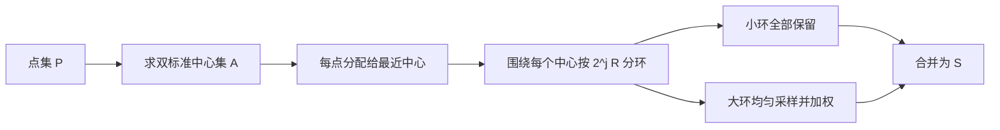
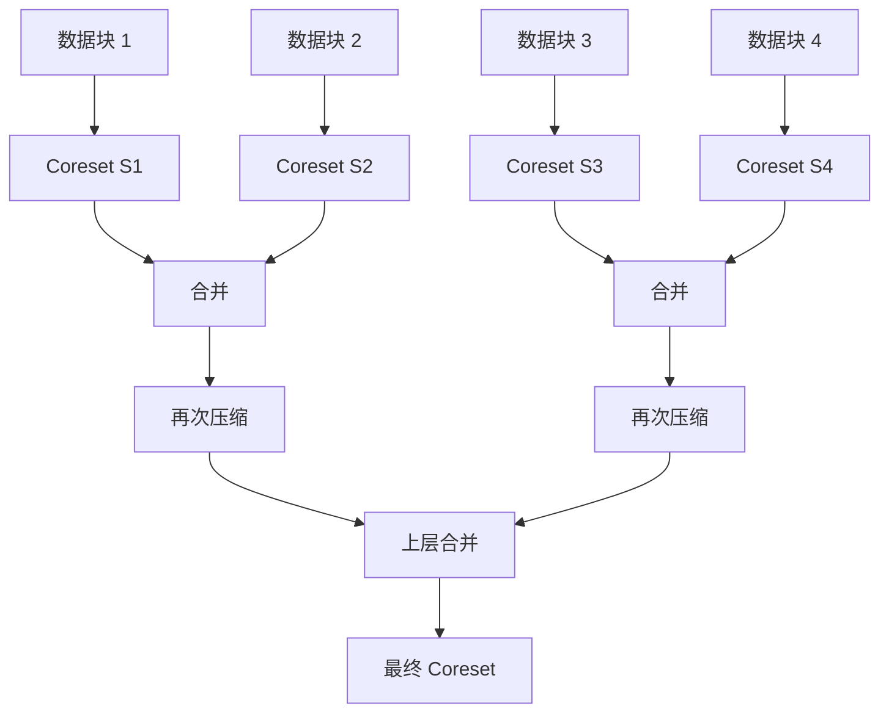
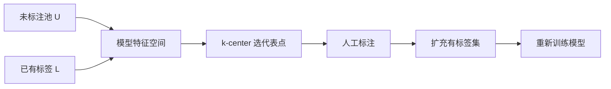

# 第七章 核心集（Coreset）

> [!abstract] 本章主线
> Coreset 的目标不是简单删掉数据，而是构造一个**带权的小规模代理数据集**，使原问题的每个候选解在小集合上的代价都近似于其在全数据上的代价。
> 
> $$
> \text{全量数据 }P
> \xrightarrow{\text{结构化采样}}
> \text{带权小集合 }S
> \xrightarrow{\text{在 }S\text{ 上求解}}
> \text{原问题的近似解}
> $$

## 本章学习目标

1. 掌握强 coreset 的统一近似定义；
2. 证明 coreset 上的近似解可以迁移到原数据；
3. 理解 $k$-median coreset 的“近似中心 + 环形分层 + 分层采样”构造；
4. 解释 coreset 大小为何可与原始数据规模弱相关；
5. 掌握 coreset 的可合并性与可传递性，从而理解流式处理；
6. 正确推导重要性采样的无偏估计；
7. 了解 coreset 在持续学习、主动学习、生成模型和 LLM 中的应用。

## 知识结构图

```mermaid
flowchart TD
    A[原始数据 P] --> B[定义目标函数 f(P,c)]
    B --> C[强 ε-coreset]
    C --> D[近似解迁移]
    C --> E[k-median 构造]
    E --> F[双标准近似中心 A]
    F --> G[按中心分簇]
    G --> H[按距离指数分环]
    H --> I[环内均匀带权采样]
    I --> J[集中不等式与统一保证]
    C --> K[Merge-and-Reduce]
    C --> L[重要性采样]
    C --> M[深度学习数据选择]
```

---

## 7.1 Coreset 的基本定义

设数据集 $P=\{p_1,\dots,p_n\}$，候选解空间为 $\mathcal F$，点 $p$ 在解 $c$ 下的代价为 $\operatorname{cost}(p,c)$。总目标函数为

$$
f(P,c)=\sum_{p\in P}\operatorname{cost}(p,c).
$$

带权集合 $S=\{(q_i,w_i)\}_{i=1}^m$ 上的目标定义为

$$
f(S,c)=\sum_{i=1}^m w_i\operatorname{cost}(q_i,c).
$$

> [!definition] 强 $\varepsilon$-coreset
> 若对**任意**候选解 $c\in\mathcal F$ 都有
> $$
> (1-\varepsilon)f(P,c)
> \le f(S,c)
> \le(1+\varepsilon)f(P,c),
> $$
> 则称 $S$ 是 $P$ 关于目标 $f$ 的一个 $\varepsilon$-coreset。

关键词是“对任意 $c$ 同时成立”。这使得 coreset 不依赖后续采用哪一种优化算法。

### 7.1.1 为什么必须加权

若一个被选中的样本代表原数据中的一大批相似点，它应承担这些点的总质量。例如，从大小为 $N$ 的分组中均匀采 $s$ 个点，每个采样实例常赋权

$$
w=\frac Ns.
$$

这样分组的总权重仍为 $s\cdot N/s=N$。

### 7.1.2 Coreset 与普通子集选择的区别

| 方法 | 主要保证 |
|---|---|
| 随机下采样 | 期望意义或针对固定统计量 |
| 原型/代表点选择 | 几何覆盖或经验性能 |
| Coreset | 对整个候选解空间统一近似目标函数 |

Coreset 是一个**问题相关**概念：同一个 $S$ 可能是 $k$-median 的好 coreset，却未必是线性回归的好 coreset。

---

## 7.2 近似解迁移定理

> [!theorem] Coreset 上求得的解如何迁移到原问题
> 设 $S$ 是 $P$ 的 $\varepsilon$-coreset。若 $C_S$ 是 $S$ 上的 $\alpha$-近似解，即
> $$
> f(S,C_S)\le\alpha\min_C f(S,C),
> $$
> 则
> $$
> f(P,C_S)
> \le
> \alpha\frac{1+\varepsilon}{1-\varepsilon}
> \min_C f(P,C).
> $$

### 详细证明

令 $C_P^*$ 是**原数据 $P$ 上的最优解**。由 coreset 下界，

$$
f(P,C_S)\le\frac{1}{1-\varepsilon}f(S,C_S).
$$

由 $C_S$ 的 $\alpha$-近似性，

$$
f(S,C_S)
\le\alpha\min_Cf(S,C)
\le\alpha f(S,C_P^*).
$$

再由 coreset 上界，

$$
f(S,C_P^*)\le(1+\varepsilon)f(P,C_P^*).
$$

三式串联：

$$
\begin{aligned}
f(P,C_S)
&\le\frac{1}{1-\varepsilon}f(S,C_S)\\
&\le\frac{\alpha}{1-\varepsilon}f(S,C_P^*)\\
&\le\alpha\frac{1+\varepsilon}{1-\varepsilon}f(P,C_P^*).
\end{aligned}
$$

证毕。

> [!warning] 讲义证明中的记号问题
> 讲义一度把 $C_{\mathrm{opt}}$ 说成“$S$ 上的最优解”，随后又把它放入 $P$ 的最优目标中。严谨证明应明确使用 $P$ 上的最优解 $C_P^*$；因为 $S$ 上最优解不一定也是 $P$ 上最优解。

当 $\varepsilon$ 很小时，

$$
\frac{1+\varepsilon}{1-\varepsilon}
=1+2\varepsilon+O(\varepsilon^2).
$$

因此 coreset 造成的近似损失仅是一个很小的乘法因子。

---

## 7.3 $k$-median 的目标函数

给定度量空间中的点集 $P$ 和中心集 $C$，定义

$$
d(p,C)=\min_{c\in C}d(p,c).
$$

加权 $k$-median 代价为

$$
\nu(C,P)=\sum_{p\in P}w(p)d(p,C),
\qquad |C|\le k.
$$

> [!definition] $(k,\varepsilon)$-coreset
> 若对所有 $|C|\le k$ 都有
> $$
> |\nu(C,S)-\nu(C,P)|
> \le\varepsilon\nu(C,P),
> $$
> 则称 $S$ 是 $P$ 的一个 $(k,\varepsilon)$-coreset。

对 $k$-means，只需将距离替换为平方距离：

$$
\mu(C,P)=\sum_{p\in P}w(p)d(p,C)^2.
$$

### 7.3.1 双标准近似中心

> [!definition] $[\alpha,\beta]$ 双标准近似
> 中心集合 $A$ 满足
> $$
> |A|\le\alpha k,
> \qquad
> \nu(A,P)\le\beta\nu_{\mathrm{opt}}(k,P),
> $$
> 则称 $A$ 是 $[\alpha,\beta]$-bicriteria center set。

它允许：

- 中心数比 $k$ 多常数倍；
- 代价比最优值大常数倍。

这样一个粗糙解更容易快速计算，但已足以指导后续采样。

---

## 7.4 环形分层构造 $k$-median Coreset

### 7.4.1 总体思路



为什么要分环？同一环内的点到近似中心的距离处于同一数量级，因此对任意候选中心集 $C$，它们的代价波动更容易被控制。若把近点和极远点混在同一层均匀采样，少量远点会造成巨大方差。

### 7.4.2 基准半径

设 $A=\{a_1,\dots,a_m\}$ 是 $[\alpha,\beta]$ 双标准解，$m\le\alpha k$。每个点分配给最近的 $a_i$，得到 $P_i$。

定义

$$
R=\frac{\nu(A,P)}{\beta n}.
$$

因为

$$
\nu(A,P)\le\beta\nu_{\mathrm{opt}},
$$

所以

$$
nR=\frac{\nu(A,P)}\beta\le\nu_{\mathrm{opt}}.
$$

$R$ 可理解为最优平均代价的一个下界尺度。

### 7.4.3 环形集合

令

$$
\phi=\lceil\log_2(\beta n)\rceil.
$$

对每个中心 $a_i$：

$$
P_{i,0}=P_i\cap B(a_i,R),
$$

对 $j\ge1$：

$$
P_{i,j}
=P_i\cap\bigl(B(a_i,2^jR)\setminus B(a_i,2^{j-1}R)\bigr).
$$

于是 $p\in P_{i,j}$ 时：

$$
2^{j-1}R<d(p,a_i)\le2^jR
\quad(j\ge1).
$$

> [!tip] 为什么只有 $O(\log n)$ 层
> 任一点到 $A$ 的距离不超过总成本 $\nu(A,P)\le\beta nR$，因此距离尺度从 $R$ 到 $\beta nR$ 只跨越 $O(\log(\beta n))$ 个二倍区间。

### 7.4.4 环内采样

设每个非空环的目标样本数为

$$
s=\Theta\!\left(
\frac{\beta^2}{\varepsilon^2}
\left(k\ln n+\ln\frac1\lambda\right)
\right).
$$

- 若 $|P_{i,j}|\le s$，全部保留；
- 否则，有放回均匀采样 $s$ 次，每次采到的实例赋权
  $$
  \frac{|P_{i,j}|}{s}.
  $$

最终

$$
S=\biguplus_{i,j}S_{i,j}.
$$

这里最好使用多重集合并 $\biguplus$，因为有放回采样可能重复抽到同一点。

### 7.4.5 伪代码

```text
Input: P, k, ε, failure probability λ
1. 计算 [α,β] 双标准中心集 A
2. 将每个 p 分配给最近的 a_i，得到 P_i
3. R ← ν(A,P)/(βn)
4. 对每个 i 和每个距离层 j：
      构造环 P_{i,j}
      若 |P_{i,j}| ≤ s：保留全部点
      否则：有放回均匀采 s 个实例，每个实例权重 |P_{i,j}|/s
5. 合并全部环的样本，返回 S
```

---

## 7.5 构造正确性的关键估计

### 7.5.1 环尺度总和有界

讲义中的关键断言是

$$
\sum_{i,j}|P_{i,j}|2^jR
\le3\nu(A,P)
\le3\beta\nu_{\mathrm{opt}}.
$$

#### 详细证明

对任意 $p\in P_{i,j}$：

- 当 $j=0$，$2^jR=R$；
- 当 $j\ge1$，由 $d(p,A)>2^{j-1}R$，有
  $$
  2^jR<2d(p,A).
  $$

统一写成较松但方便求和的形式：

$$
2^jR\le2d(p,A)+R.
$$

因此

$$
\begin{aligned}
\sum_{i,j}|P_{i,j}|2^jR
&=\sum_{i,j}\sum_{p\in P_{i,j}}2^jR\\
&\le\sum_{p\in P}\bigl(2d(p,A)+R\bigr)\\
&=2\nu(A,P)+nR\\
&=2\nu(A,P)+\frac{\nu(A,P)}\beta\\
&\le3\nu(A,P).
\end{aligned}
$$

又因 $\nu(A,P)\le\beta\nu_{\mathrm{opt}}$，得到结论。

每个环的直径满足

$$
\operatorname{diam}(P_{i,j})\le2\cdot2^jR,
$$

所以

$$
\sum_{i,j}|P_{i,j}|\operatorname{diam}(P_{i,j})
\le6\beta\nu_{\mathrm{opt}}.
$$

### 7.5.2 这一估计为什么重要

对固定候选中心集 $C$，环内随机样本估计的是

$$
\sum_{p\in P_{i,j}}d(p,C).
$$

环直径控制同一环内不同点的代价差异；上面的总和界则保证把所有环的误差累加后，仍可被全局最优尺度控制。

完整统一保证还需：

1. 对固定 $C$ 使用集中不等式；
2. 对所有候选中心集做离散化或组合计数；
3. 使用联合界；
4. 与粗中心 $A$ 的成功事件合并。

讲义引用的结论给出：以至少 $1-\lambda$ 的概率，得到 $(k,\varepsilon)$-coreset。

### 7.5.3 大小与时间复杂度

无权点集下，环数约为

$$
O(k\log n),
$$

每环最多保留 $s$ 个实例，因此

$$
|S|
=O\!\left(
k\varepsilon^{-2}
\left(k\log n+\log\frac1\lambda\right)
\log n
\right).
$$

讲义给出的运行时间为

$$
O\!\left(nk\log\frac1\lambda\right),
$$

主要由双标准中心的计算和点到中心的分配主导。

> [!note] “小”不一定完全独立于 $n$
> 这里的 coreset 大小仍含 $\log n$。Coreset 的优势是从线性依赖 $n$ 降到对数依赖；其他构造在特定空间中还可进一步去除对 $n$ 的依赖。

---

## 7.6 Streaming 与 Merge-and-Reduce

### 7.6.1 可合并性

若 $P_1,P_2$ 不相交，$S_1,S_2$ 分别是它们的 $\varepsilon$-coreset，则对任意 $C$：

$$
\begin{aligned}
f(S_1\cup S_2,C)
&=f(S_1,C)+f(S_2,C)\\
&\in (1\pm\varepsilon)\bigl(f(P_1,C)+f(P_2,C)\bigr).
\end{aligned}
$$

所以 $S_1\cup S_2$ 是 $P_1\cup P_2$ 的 $\varepsilon$-coreset。

### 7.6.2 可传递性

若 $S_1$ 是 $S_2$ 的 $\varepsilon$-coreset，$S_2$ 是 $S_3$ 的 $\delta$-coreset，则

$$
f(S_1,C)
\le(1+\varepsilon)(1+\delta)f(S_3,C),
$$

下界类似。总乘法误差可写为

$$
(1+\varepsilon)(1+\delta)-1
=\varepsilon+\delta+\varepsilon\delta.
$$

### 7.6.3 Merge-and-Reduce 图示



每经过一层会累积少量误差，因此可把每层误差预算设置为 $\varepsilon/O(\log n)$。

---

## 7.7 重要性采样

### 7.7.1 均匀采样的局限

设要估计

$$
\mu=\frac1n\sum_{i=1}^n q_i,
\qquad 0\le q_i\le\Delta.
$$

均匀采样时，Hoeffding 界给出典型样本量

$$
m=O\!\left(\frac{\Delta^2}{\varepsilon^2}\ln\frac1\delta\right).
$$

若只有极少数 $q_i$ 接近 $\Delta$，而绝大多数很小，这个由最大值决定的界会很保守。

### 7.7.2 正确归一化的重要性采样

选择上界或重要性分数 $\phi_i>0$，并假设

$$
0\le q_i\le\phi_i.
$$

令

$$
\Phi=\sum_{i=1}^n\phi_i,
\qquad
p_i=\frac{\phi_i}{\Phi}.
$$

采到索引 $I=i$ 时，返回估计量

$$
Z=\frac{q_i}{np_i}
=\frac{\Phi q_i}{n\phi_i}.
$$

则

$$
\mathbb E[Z]
=\sum_i p_i\frac{q_i}{np_i}
=\frac1n\sum_iq_i
=\mu.
$$

因此它是无偏的。又因为 $q_i\le\phi_i$，

$$
0\le Z\le\frac\Phi n=\bar\phi,
$$

其中 $\bar\phi$ 是重要性上界的平均值。于是样本量尺度变为

$$
m=O\!\left(
\frac{\bar\phi^2}{\varepsilon^2}
\ln\frac1\delta
\right).
$$

当 $\bar\phi\ll\Delta$ 时，比均匀采样显著更省。

> [!warning] 讲义公式的归一化勘误
> 讲义定义 $\phi=\frac1n\sum_i\phi_i$，却写采样概率 $\phi_i/\phi$，这些“概率”之和为 $n$，不是 1。若沿用平均值记号 $\phi=\Phi/n$，正确概率应为
> $$
> p_i=\frac{\phi_i}{n\phi},
> $$
> 对应重加权值为
> $$
> Z=\frac{\phi}{\phi_i}q_i.
> $$

### 7.7.3 与 Coreset 的关系

在一般优化问题中，点 $p_i$ 的“重要性”可由灵敏度（sensitivity）刻画：

$$
s_i=\sup_{c\in\mathcal F}
\frac{\operatorname{cost}(p_i,c)}{f(P,c)}.
$$

高灵敏度点可能在某些候选解下主导总成本，应以更高概率采样；采样后使用逆概率权重保持无偏。

---

## 7.8 深度学习中的 Coreset

### 7.8.1 持续学习

持续学习按任务序列 $X_1,X_2,\dots$ 训练，模型容易发生灾难性遗忘。重放方法保存小型记忆 $M$，训练新任务时优化

$$
L(\theta)
=L(\theta;X_{t+1})+\lambda L(\theta;M).
$$

Coreset 的任务是：在固定内存预算下，选择最能代表旧任务的样本。

Online Coreset Selection 的典型评分包括：

- **代表性：**样本梯度与当前 mini-batch 平均梯度方向相近；
- **多样性：**被选样本之间梯度相似度较低；
- **亲和性：**样本对记忆中既有知识干扰较小或方向协调。

### 7.8.2 主动学习

给定少量有标签集合 $L$ 和大量未标注池 $U$，选择 $k$ 个待标注样本：

$$
\min_{S\subseteq U,\ |S|=k}
\max_{x\in U}
\min_{s\in S\cup L}\Delta(x,s).
$$

这是特征空间中的 $k$-center 覆盖问题：最小化任意未标注点到最近已标注/待标注点的最大距离。



### 7.8.3 生成模型

Small-GAN 在两侧都做 $k$-center 选择：

- 在噪声 batch 中选多样化潜变量；
- 在真实数据的 Inception 嵌入中选代表样本。

它不是单纯减少 batch，而是让每个 batch 覆盖更广，从而稳定 GAN 的对抗训练。

### 7.8.4 大语言模型

LLM 微调中的数据 coreset 面临三个额外难点：

1. 混合数据源规模不平衡，小数据源容易被完全忽略；
2. Adam 使用历史二阶矩缩放，原始梯度距离未必对应实际参数更新距离；
3. 梯度维度极高，距离集中与存储成本严重。

讲义介绍的 CoLM 思路包括：

- 小数据源样本优先保留；
- 按优化器历史统计对梯度归一化；
- 在较小投影层上进行零阶梯度估计和稀疏化；
- 从大候选 mini-batch 中选择较小的梯度近似子集。

> [!important] 经典 coreset 与现代训练子集的差别
> 经典强 coreset 要求对所有候选解统一近似；深度学习方法往往只近似**当前参数附近的梯度或训练动态**。后者通常更实用，但理论保证更局部、更依赖模型状态。

---

## 定义与符号速查

| 符号 | 含义 |
|---|---|
| $P$ | 原始数据集 |
| $S$ | 带权 coreset |
| $f(P,c)$ | 解 $c$ 在数据集 $P$ 上的目标值 |
| $\varepsilon$ | 乘法近似误差 |
| $\lambda$ | 构造失败概率（本章构造部分） |
| $\nu(C,P)$ | $k$-median 目标值 |
| $A$ | 双标准近似中心集 |
| $R$ | 环形划分的基础距离尺度 |
| $P_{i,j}$ | 中心 $a_i$ 周围的第 $j$ 个环 |
| $s$ | 每个大环的采样数 |
| $p_i$ | 重要性采样概率 |

## 易错点

1. Coreset 不是“任意小子集”，而是带有目标函数近似保证的加权集合。
2. 定义必须对所有候选解 $c$ 同时成立，而非只对最优解成立。
3. 证明近似迁移时，应使用原数据上的最优解 $C_P^*$。
4. $k$-median 使用距离，$k$-means 使用平方距离。
5. 有放回采样应把 $S$ 看作带权多重集。
6. 重要性采样概率必须归一化为和等于 1。
7. 逆概率重加权是无偏性的关键；只提高采样概率而不改权重会改变目标。
8. Merge-and-Reduce 多层压缩会累积乘法误差。

## 本章总结

> [!summary]
> - 强 coreset 统一近似所有候选解的目标值。
> - 在 coreset 上的 $\alpha$-近似解可转化为原数据上的 $\alpha(1+\varepsilon)/(1-\varepsilon)$-近似解。
> - $k$-median 构造先求常数近似中心，再按二倍距离尺度分环并分层采样。
> - 环形划分把同层点的代价尺度控制在相近范围内，从而降低方差。
> - Coreset 的可合并性和可传递性支持流式及分布式 Merge-and-Reduce。
> - 重要性采样以高概率抽取高影响点，并通过逆概率权重保持无偏。
> - 在深度学习中，coreset 常被实现为覆盖、梯度匹配或训练动态近似。

---

## 自测题

> [!question] 1. 定义
> 为什么 coreset 定义要求对所有候选解同时成立，而不能只要求近似最优解的目标值？

> [!question] 2. 近似迁移
> 若 $\alpha=1.1$，$\varepsilon=0.05$，则 coreset 上的解在原数据上的近似因子至多是多少？

> [!question] 3. 环形划分
> 为什么环半径采用 $R,2R,4R,\dots$，而不是固定宽度 $R,2R,3R,\dots$？

> [!question] 4. 权重
> 一个环有 1000 个点，从中有放回采 20 次，每个采样实例应赋多大权重？为什么？

> [!question] 5. 关键估计
> 从 $2^jR\le2d(p,A)+R$ 推导
> $$
> \sum_{i,j}|P_{i,j}|2^jR\le3\nu(A,P).
> $$

> [!question] 6. Streaming
> 若每层 coreset 的误差都是 $\eta$，经过 $L$ 层后总误差近似是多少？为了使总误差约为 $\varepsilon$，应如何选 $\eta$？

> [!question] 7. 重要性采样
> 设 $q=(1,1,8)$，取 $\phi=q$。写出采样概率，并验证单次逆概率估计量对均值无偏。

> [!question] 8. 主动学习
> 基于 $k$-center 的主动学习主要追求“不确定性”还是“覆盖性”？它可能遗漏什么信息？

## 自测题答案

> [!success]- 1. 答案
> 因为构造 coreset 时还不知道后续算法会考察哪个候选解。统一保证确保无论优化算法如何搜索，目标函数景观都被近似保留；只近似某个最优解无法防止其他解的排序被严重扭曲。

> [!success]- 2. 答案
> $$
> 1.1\times\frac{1.05}{0.95}
> \approx1.2158.
> $$
> 因此约为 $1.216$-近似。

> [!success]- 3. 答案
> 指数分环保证每层内最大和最小距离只差常数倍，同时总层数只有 $O(\log n)$。固定宽度分层在远距离区域会产生过多层，并且相对尺度控制较差。

> [!success]- 4. 答案
> 每个采样实例权重为 $1000/20=50$。20 个实例的总权重为 1000，从而保持该环的总质量。

> [!success]- 5. 答案
> $$
> \begin{aligned}
> \sum_{i,j}|P_{i,j}|2^jR
> &=\sum_{i,j}\sum_{p\in P_{i,j}}2^jR\\
> &\le\sum_{p\in P}(2d(p,A)+R)\\
> &=2\nu(A,P)+nR\\
> &=2\nu(A,P)+\nu(A,P)/\beta\\
> &\le3\nu(A,P).
> \end{aligned}
> $$

> [!success]- 6. 答案
> 乘法因子约为 $(1+\eta)^L\approx1+L\eta$，所以总误差约为 $L\eta$。通常令 $\eta=\Theta(\varepsilon/L)$。

> [!success]- 7. 答案
> $\Phi=10$，所以 $p=(0.1,0.1,0.8)$。均值为 $10/3$。采到任意 $i$ 时
> $$
> Z=\frac{q_i}{3p_i}=\frac{10}{3},
> $$
> 因而 $\mathbb E Z=10/3$，且此例方差恰为 0。

> [!success]- 8. 答案
> 它主要追求特征空间的覆盖性，使最远点到已选集合的距离尽可能小。它未直接使用模型预测不确定性、类别边界信息或标注噪声，因此可能选到覆盖良好但对决策边界帮助较小的点。

---

**上一章：**[[6|第六章 VC 维与 PAC 学习]]　　**下一章：**[[8|第八章 最优传输]]
