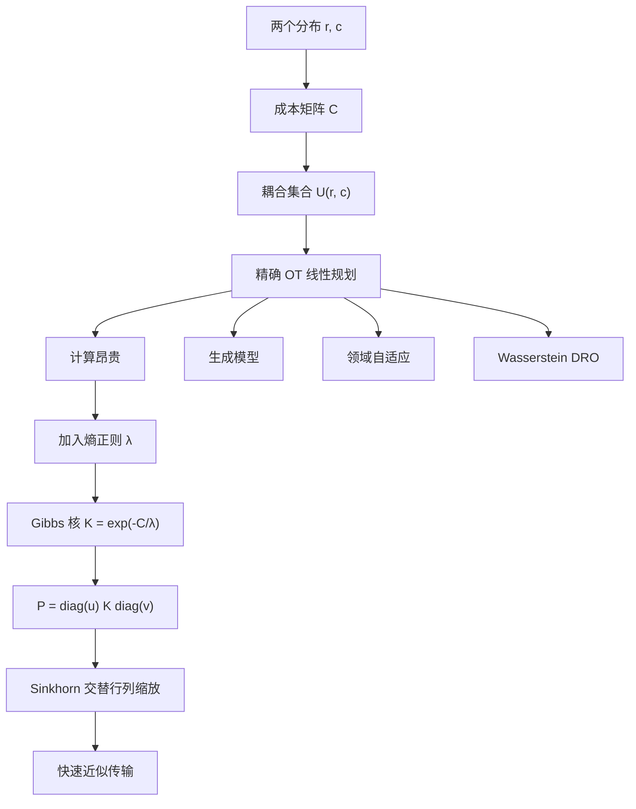
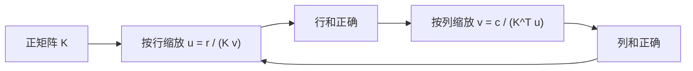
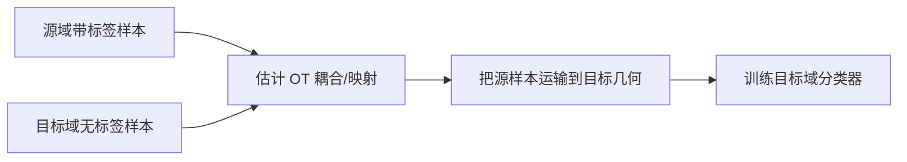

# 第八章 最优传输（Optimal Transport）

> [!abstract] 本章主线
> 最优传输把“比较两个分布”转化为“把一个分布的质量搬运成另一个分布，最少需要多少代价”。精确 OT 是线性规划，规模大时昂贵；加入熵正则后，最优耦合具有矩阵缩放结构，可用 Sinkhorn 迭代高效求解。

## 本章学习目标

1. 从“搬土”直觉写出 Kantorovich 离散 OT；
2. 理解传输计划、边际约束和成本矩阵；
3. 解释熵正则化如何把稀疏线性规划变成严格凸的平滑问题；
4. 推导 $P=\operatorname{diag}(u)K\operatorname{diag}(v)$；
5. 掌握 Sinkhorn 的交替缩放公式、复杂度和数值问题；
6. 区分精确 Wasserstein 距离、正则化目标、正则化传输成本和 Sinkhorn divergence；
7. 理解 OT 在生成模型、领域自适应和 WDRO 中的作用。

## 知识结构图



---

## 8.1 从搬土问题到 Kantorovich OT

### 8.1.1 离散分布

设

$$
r\in\mathbb R_+^n,\qquad c\in\mathbb R_+^m,
$$

满足

$$
\sum_{i=1}^n r_i=1,
\qquad
\sum_{j=1}^m c_j=1.
$$

$r_i$ 是源位置 $i$ 的质量，$c_j$ 是目标位置 $j$ 需要接收的质量。

成本矩阵

$$
C\in\mathbb R_+^{n\times m}
$$

的元素 $C_{ij}$ 表示把一个单位质量从源位置 $i$ 运到目标位置 $j$ 的成本。

### 8.1.2 传输计划与边际约束

传输计划

$$
P\in\mathbb R_+^{n\times m}
$$

中，$P_{ij}$ 表示从 $i$ 运到 $j$ 的质量。

它必须满足：

$$
P\mathbf 1_m=r,
\qquad
P^\top\mathbf 1_n=c.
$$

可行耦合集合定义为

$$
U(r,c)=
\left\{
P\ge0:P\mathbf1_m=r,\ P^\top\mathbf1_n=c
\right\}.
$$

> [!tip] 行和与列和
> - 第 $i$ 行总和等于源质量 $r_i$，表示该点的全部质量都被运走；
> - 第 $j$ 列总和等于目标质量 $c_j$，表示该点收到恰好所需的质量。

### 8.1.3 Kantorovich 线性规划

精确 OT 成本为

$$
L_C(r,c)
=
\min_{P\in U(r,c)}
\langle P,C\rangle_F
=
\min_{P\in U(r,c)}
\sum_{i,j}P_{ij}C_{ij}.
$$

若 $C_{ij}=d(x_i,y_j)^p$，则通常定义

$$
W_p(r,c)
=
L_C(r,c)^{1/p}.
$$

> [!warning] OT 成本与 Wasserstein 距离
> 只有当成本由底层度量的 $p$ 次方产生，并取 $p$ 次根等条件满足时，才严格称为 $p$-Wasserstein 距离。一般成本矩阵下，$L_C$ 更稳妥地称为最优传输成本。

### 8.1.4 一个两点例子

设

$$
r=(0.7,0.3),\qquad c=(0.4,0.6),
$$

同位置运输成本为 0，跨位置成本为 1：

$$
C=
\begin{pmatrix}
0&1\\
1&0
\end{pmatrix}.
$$

源点 1 有 0.7，而目标点 1 只需 0.4，所以至少有 0.3 质量要从位置 1 运到位置 2。最优计划是

$$
P^*=
\begin{pmatrix}
0.4&0.3\\
0&0.3
\end{pmatrix},
$$

总成本为 $0.3$。

---

## 8.2 为什么精确 OT 昂贵

离散 OT 是含 $nm$ 个变量的线性规划。通用精确算法在规模增大时开销高，且存储完整 $C$ 与 $P$ 需要

$$
O(nm)
$$

空间。若 $n=m=N$，仅矩阵就有 $N^2$ 个元素。

实际瓶颈包括：

- 高分辨率图像产生大量支撑点；
- 文档或词汇分布的支撑很大；
- 训练过程中需重复计算许多批次间 OT；
- GPU 上通用线性规划不易获得高吞吐。

因此需要可并行、以矩阵乘法为核心的近似算法。

---

## 8.3 熵正则化

### 8.3.1 传输计划的熵

讲义采用

$$
H(P)
=-\sum_{i,j}P_{ij}(\log P_{ij}-1).
$$

当总质量为 1 时，它与 Shannon 熵只差常数 1。大熵意味着质量分配更分散、更平滑。

### 8.3.2 正则化 OT

加入正则系数 $\lambda>0$：

$$
L_C^\lambda(r,c)
=
\min_{P\in U(r,c)}
\left\{
\langle P,C\rangle_F-\lambda H(P)
\right\}.
$$

等价地，去掉常数后：

$$
\min_{P\in U(r,c)}
\sum_{i,j}
\left[
P_{ij}C_{ij}
+\lambda P_{ij}\log P_{ij}
\right].
$$

参数作用：

- $\lambda\to0$：趋近精确 OT，耦合通常更尖锐；
- $\lambda$ 较大：熵更重要，耦合更接近独立耦合 $rc^\top$；
- 小 $\lambda$ 精确但数值更困难；大 $\lambda$ 稳定但偏差更大。

> [!warning] 图 8.2 文字勘误
> 原讲义图注称“随着 $\lambda$ 变大，解越来越接近精确 OT”，这与本章采用的目标 $\langle P,C\rangle-\lambda H(P)$ 相反。按此参数化，应该是 **$\lambda\to0$ 时趋近精确 OT**。

### 8.3.3 为什么熵正则化更容易优化

函数 $x\log x$ 在 $x>0$ 上严格凸，因此正则化目标在可行多面体内部严格凸，最优解通常唯一且为正。平滑性使其可转化为对角矩阵缩放，而非一般线性规划。

---

## 8.4 KL 约束与熵约束

定义独立耦合

$$
Q=rc^\top,
\qquad Q_{ij}=r_ic_j.
$$

对任意 $P\in U(r,c)$，有

$$
\operatorname{KL}(P\|rc^\top)
=\sum_{i,j}P_{ij}\log\frac{P_{ij}}{r_ic_j}.
$$

### 8.4.1 详细推导

展开：

$$
\begin{aligned}
\operatorname{KL}(P\|rc^\top)
&=\sum_{i,j}P_{ij}\log P_{ij}
-\sum_{i,j}P_{ij}\log r_i
-\sum_{i,j}P_{ij}\log c_j.
\end{aligned}
$$

利用边际约束：

$$
\sum_jP_{ij}=r_i,
\qquad
\sum_iP_{ij}=c_j,
$$

所以

$$
\begin{aligned}
\operatorname{KL}(P\|rc^\top)
&=\sum_{i,j}P_{ij}\log P_{ij}
-\sum_i r_i\log r_i
-\sum_j c_j\log c_j\\
&=-h(P)+h(r)+h(c),
\end{aligned}
$$

其中 $h(z)=-\sum z\log z$。

因此

$$
\operatorname{KL}(P\|rc^\top)\le\alpha
$$

等价于

$$
h(P)\ge h(r)+h(c)-\alpha.
$$

这说明“耦合不能离独立耦合太远”与“耦合必须保持足够高的熵”是同一约束的两种表述。

### 8.4.2 凸性

集合

$$
U_\alpha(r,c)
=\{P\in U(r,c):\operatorname{KL}(P\|rc^\top)\le\alpha\}
$$

是凸集，因为：

1. $U(r,c)$ 由线性等式和非负约束定义，是凸集；
2. 对固定 $rc^\top$，$\operatorname{KL}(P\|rc^\top)$ 关于 $P$ 凸；
3. 凸函数的子水平集是凸集；
4. 凸集交集仍为凸集。

---

## 8.5 Sinkhorn 解的结构

### 8.5.1 用拉格朗日乘子推导

考虑去除无关常数后的问题：

$$
\min_{P\ge0}
\sum_{i,j}
\left(P_{ij}C_{ij}+\lambda P_{ij}(\log P_{ij}-1)\right)
$$

满足

$$
\sum_jP_{ij}=r_i,
\qquad
\sum_iP_{ij}=c_j.
$$

引入乘子 $\alpha_i,\beta_j$，拉格朗日函数为

$$
\mathcal L
=\sum_{i,j}
\left(P_{ij}C_{ij}+\lambda P_{ij}(\log P_{ij}-1)\right)
+\sum_i\alpha_i\left(r_i-\sum_jP_{ij}\right)
+\sum_j\beta_j\left(c_j-\sum_iP_{ij}\right).
$$

对 $P_{ij}$ 求偏导并令零：

$$
C_{ij}+\lambda\log P_{ij}-\alpha_i-\beta_j=0.
$$

因此

$$
P_{ij}
=\exp\left(\frac{\alpha_i}{\lambda}\right)
\exp\left(-\frac{C_{ij}}{\lambda}\right)
\exp\left(\frac{\beta_j}{\lambda}\right).
$$

令

$$
u_i=e^{\alpha_i/\lambda},
\qquad
K_{ij}=e^{-C_{ij}/\lambda},
\qquad
v_j=e^{\beta_j/\lambda},
$$

得到

$$
\boxed{
P^\lambda=\operatorname{diag}(u)K\operatorname{diag}(v)
}
$$

这就是 Sinkhorn 算法成立的核心结构。

### 8.5.2 边际约束转化为缩放方程

由 $P\mathbf1=r$：

$$
u\odot(Kv)=r
\quad\Longrightarrow\quad
u=r\oslash(Kv).
$$

由 $P^\top\mathbf1=c$：

$$
v\odot(K^\top u)=c
\quad\Longrightarrow\quad
v=c\oslash(K^\top u).
$$

这里 $\odot$、$\oslash$ 分别表示逐元素乘法和除法。

---

## 8.6 Sinkhorn 算法

### 8.6.1 迭代过程

```text
Input: r, c, cost matrix C, regularization λ
K ← exp(-C/λ)          # elementwise
v ← 1
repeat until marginal error is small:
    u ← r / (K v)
    v ← c / (Kᵀ u)
P ← diag(u) K diag(v)
return P
```

一次更新 $u$ 会把行和校准为 $r$，随后更新 $v$ 会把列和校准为 $c$。两个操作交替进行，逐渐同时满足两组边际约束。



### 8.6.2 停止条件

常用边际残差：

$$
\|P\mathbf1-r\|_1
+\|P^\top\mathbf1-c\|_1
\le\tau.
$$

也可监控 $u,v$ 或目标值的相对变化。

### 8.6.3 复杂度

稠密矩阵情形，每轮主要计算

$$
Kv,
\qquad
K^\top u,
$$

时间复杂度为

$$
O(nm),
$$

存储成本也为 $O(nm)$。若迭代 $T$ 轮，总时间为 $O(Tnm)$。

与通用精确 OT 相比，它只使用高度并行的矩阵-向量运算，非常适合 GPU。

### 8.6.4 数值稳定性

当 $\lambda$ 很小时，$K_{ij}=e^{-C_{ij}/\lambda}$ 可能下溢为 0。常见处理：

- 在对数域中更新对偶变量；
- 使用 log-sum-exp；
- 周期性吸收缩放因子（stabilization）；
- 先用较大 $\lambda$，再逐步减小（epsilon scaling）；
- 不显式存储 $K$，使用结构化核乘法。

---

## 8.7 “Sinkhorn 距离”到底指什么

术语在文献中并不完全统一，需要区分：

1. **精确 OT 成本**
   $$
   L_C(r,c)=\langle P^*,C\rangle;
   $$
2. **熵正则化目标值**
   $$
   L_C^\lambda(r,c)
   =\langle P^\lambda,C\rangle-\lambda H(P^\lambda);
   $$
3. **正则化最优计划的纯运输成本**
   $$
   d_{C,\lambda}(r,c)=\langle P^\lambda,C\rangle;
   $$
4. **Sinkhorn divergence**
   $$
   S_\lambda(r,c)
   =L_C^\lambda(r,c)
   -\frac12L_C^\lambda(r,r)
   -\frac12L_C^\lambda(c,c).
   $$

正则化计划可行，所以

$$
\langle P^\lambda,C\rangle\ge L_C(r,c).
$$

但正则化目标因减去熵项，可能小于精确 OT 成本。

> [!warning] 度量性质
> 普通熵正则化 OT 一般存在“自距离偏差”，即 $L_C^\lambda(r,r)$ 不一定为 0，因此不一定是严格意义上的距离。去偏后的 Sinkhorn divergence 用来缓解这一问题。

讲义中的三角不等式定理针对的是带 KL/熵约束的特殊定义 $d_{M,\alpha}$，不能不加区分地推广到所有熵正则化目标。

### 8.7.1 粘合引理的直觉

若 $P$ 耦合 $x$ 与 $y$，$Q$ 耦合 $y$ 与 $z$，可通过中间状态 $y_j$ 合成 $x$ 与 $z$ 的耦合：

$$
S_{ik}=\sum_j\frac{P_{ij}Q_{jk}}{y_j}.
$$

若底层成本满足三角不等式

$$
M_{ik}\le M_{ij}+M_{jk},
$$

则合成运输的成本不超过两段成本之和。这是 Wasserstein 三角不等式的核心机制。

---

## 8.8 应用一：生成模型与动态 OT

生成模型希望找到映射 $T$，使

$$
Z_0\sim\pi_0
\quad\Longrightarrow\quad
T(Z_0)\sim\pi_1.
$$

- $\pi_0$ 常为高斯噪声；
- $\pi_1$ 为真实数据分布。

Wasserstein-2 距离有 Benamou–Brenier 动态形式：

$$
W_2^2(\mu_0,\mu_1)
=
\inf_{(\rho_t,v_t)}
\int_0^1\int
\rho_t(x)\|v_t(x)\|_2^2\,dx\,dt,
$$

满足连续性方程

$$
\partial_t\rho_t+
abla\cdot(\rho_tv_t)=0,
\qquad
\rho_0=\mu_0,
\quad
\rho_1=\mu_1.
$$

含义：寻找一个随时间流动的概率密度路径，使总动能最小。

这与 flow matching、Schrödinger bridge 以及部分扩散模型理论密切相关：模型学习速度场或随机过程，把简单分布连续运输到数据分布。

---

## 8.9 应用二：领域自适应

源域分布为 $\mu_s$，目标域分布为 $\mu_t$。希望找到映射 $T$：

$$
T_\#\mu_s=\mu_t,
$$

其中前推测度定义为

$$
(T_\#\mu)(B)=\mu(T^{-1}(B)).
$$

Monge 形式为

$$
T^*=
\arg\min_T
\int c(x,T(x))\,d\mu_s(x)
\quad\text{s.t.}\quad
T_\#\mu_s=\mu_t.
$$

流程：



OT 利用了特征空间几何，但仅对齐边缘分布可能把不同类别错误匹配，因此实际方法常加入标签一致性、类条件成本或正则化。

---

## 8.10 应用三：Wasserstein 分布鲁棒优化

### 8.10.1 从 SAA 到 DRO

真实分布 $P$ 未知，仅观察样本 $\xi_1,\dots,\xi_n$，经验分布为

$$
\widehat P_n=\frac1n\sum_{i=1}^n\delta_{\xi_i}.
$$

样本平均近似（SAA）求

$$
\min_{x\in\mathcal X}
\frac1n\sum_{i=1}^nf(x,\xi_i).
$$

它可能对样本过拟合。DRO 改为在一个可能分布集合 $\mathcal P$ 中优化最坏情况：

$$
\min_{x\in\mathcal X}
\sup_{Q\in\mathcal P}
\mathbb E_Q[f(x,\xi)].
$$

### 8.10.2 Wasserstein 模糊集

定义

$$
\mathcal P_\varepsilon(\widehat P_n)
=
\{Q:W_p(Q,\widehat P_n)\le\varepsilon\}.
$$

$\varepsilon$ 越大，允许的分布偏移越强，解越保守。

与 KL 球相比，Wasserstein 球允许分布支撑位置移动，因而即使经验分布离散、真实分布连续也有意义。

### 8.10.3 对偶重构

在 $p=1$ 等合适条件下：

$$
\sup_{Q:W_1(Q,\widehat P_n)\le\varepsilon}
\mathbb E_Q[f(x,\xi)]
$$

可重写为

$$
\inf_{\lambda\ge0}
\left\{
\lambda\varepsilon
+
\frac1n\sum_{i=1}^n
\sup_{z\in\mathcal Z}
\bigl[f(x,z)-\lambda d(z,\xi_i)\bigr]
\right\}.
$$

解释：

- 对手把每个样本 $\xi_i$ 移动到更坏的位置 $z$；
- 损失增加为 $f(x,z)$；
- 移动距离受价格 $\lambda d(z,\xi_i)$ 惩罚；
- $\lambda\varepsilon$ 是整个 Wasserstein 预算的对偶成本。

原本在所有概率分布上的无穷维优化，变成一个标量 $\lambda$ 加若干逐样本最坏扰动问题。

> [!note] 公式排版修正
> 上式中大括号应完整写为
> $$
> \inf_{\lambda\ge0}
> \left\{
> \lambda\varepsilon+
> \frac1n\sum_i\sup_z[f(x,z)-\lambda d(z,\xi_i)]
> \right\}.
> $$

---

## 定义与符号速查

| 符号 | 含义 |
|---|---|
| $r,c$ | 源、目标离散分布 |
| $C_{ij}$ | 单位质量从 $i$ 运到 $j$ 的成本 |
| $P_{ij}$ | 实际运输质量 |
| $U(r,c)$ | 满足两组边际约束的耦合集合 |
| $L_C(r,c)$ | 精确 OT 成本 |
| $H(P)$ | 传输计划的熵 |
| $\lambda$ | 熵正则强度 |
| $K=e^{-C/\lambda}$ | Gibbs 核 |
| $u,v$ | 行、列缩放向量 |
| $T_\#\mu$ | 测度的前推 |
| $\widehat P_n$ | 经验分布 |
| $\mathcal P_\varepsilon$ | Wasserstein 模糊集 |

## 易错点

1. $P_{ij}$ 是质量，不是“是否匹配”的二值变量。
2. 行边际和列边际必须同时满足。
3. $\lambda$ 越小越接近精确 OT，但数值越不稳定。
4. 正则化目标值和纯运输成本不是同一个量。
5. 熵正则化 OT 一般不自动满足严格距离的所有公理。
6. Sinkhorn 每步只保证一组边际，交替迭代后才共同逼近。
7. 在领域自适应中，分布对齐不等于类别语义一定对齐。
8. WDRO 的“分布式”是 distributionally robust，不是 distributed computing。

## 本章总结

> [!summary]
> - OT 在所有满足边际约束的耦合中寻找最小运输成本。
> - 熵正则使问题严格凸，并产生 $P=\operatorname{diag}(u)K\operatorname{diag}(v)$ 的结构。
> - Sinkhorn 通过交替行列缩放求 $u,v$，每轮只需矩阵-向量乘法。
> - 小 $\lambda$ 更精确，大 $\lambda$ 更平滑稳定。
> - KL 到独立耦合的约束等价于对联合熵设置下界。
> - 动态 OT 把分布变换写成满足连续性方程的最小动能流。
> - WDRO 使用 Wasserstein 球描述分布不确定性，并可通过对偶转成有限维优化。

---

## 自测题

> [!question] 1. 可行耦合
> 给定 $r=(0.6,0.4)$、$c=(0.5,0.5)$，判断
> $$
> P=\begin{pmatrix}0.4&0.2\\0.1&0.3\end{pmatrix}
> $$
> 是否属于 $U(r,c)$。

> [!question] 2. 熵参数
> 在本章参数化下，$\lambda\to0$ 和 $\lambda\to\infty$ 时，最优耦合分别趋向什么？

> [!question] 3. 结构推导
> 为什么正则化一阶条件中会出现指数核 $e^{-C_{ij}/\lambda}$？

> [!question] 4. Sinkhorn 更新
> 已知当前 $v$，为什么 $u=r/(Kv)$ 能使 $P=\operatorname{diag}(u)K\operatorname{diag}(v)$ 的行和恰为 $r$？

> [!question] 5. 复杂度
> 当 $n=m=5000$ 时，显式存储一个双精度 $K$ 大约需要多少内存？按每元素 8 字节估算。

> [!question] 6. 距离偏差
> 为什么熵正则化 OT 的 $L_C^\lambda(r,r)$ 可能不为 0？Sinkhorn divergence 如何修正？

> [!question] 7. 前推测度
> 用一句话解释 $T_\#\mu=\nu$。

> [!question] 8. WDRO
> Wasserstein 球半径 $\varepsilon$ 增大，对解的鲁棒性和保守性有何影响？

## 自测题答案

> [!success]- 1. 答案
> 行和为 $(0.6,0.4)$，列和为 $(0.5,0.5)$，且元素非负，所以属于 $U(r,c)$。

> [!success]- 2. 答案
> $\lambda\to0$ 时趋近精确最优传输计划；$\lambda\to\infty$ 时熵主导，趋近最大熵的独立耦合 $rc^\top$。

> [!success]- 3. 答案
> 熵项导数是 $\lambda\log P_{ij}$。一阶条件给出 $\log P_{ij}=(\alpha_i+\beta_j-C_{ij})/\lambda$，两边指数化后自然得到 $e^{-C_{ij}/\lambda}$。

> [!success]- 4. 答案
> 行和为
> $$
> P\mathbf1
> =\operatorname{diag}(u)Kv
> =u\odot(Kv).
> $$
> 取 $u=r\oslash(Kv)$ 后，该值逐元素等于 $r$。

> [!success]- 5. 答案
> 元素数为 $25\times10^6$，内存为
> $$
> 25\times10^6\times8\approx200\text{ MB}.
> $$
> 尚未包括 $P$、梯度及其他缓存。

> [!success]- 6. 答案
> 熵奖励鼓励分散质量，即使源和目标相同，正则化最优计划也可能不完全沿对角线，因此自成本不为零。Sinkhorn divergence 减去两端各自的自成本：
> $$
> S_\lambda(r,c)=L_\lambda(r,c)-\tfrac12L_\lambda(r,r)-\tfrac12L_\lambda(c,c).
> $$

> [!success]- 7. 答案
> 从 $x\sim\mu$ 采样并计算 $T(x)$，所得随机变量的分布就是 $\nu$。

> [!success]- 8. 答案
> 模糊集中允许的分布更多，模型能抵抗更大的分布偏移，但最坏情况更恶劣，因此决策通常更保守、经验性能可能下降。

---

**上一章：**[[7|第七章 核心集]]　　**下一章：**[[9|第九章 分布式算法]]
