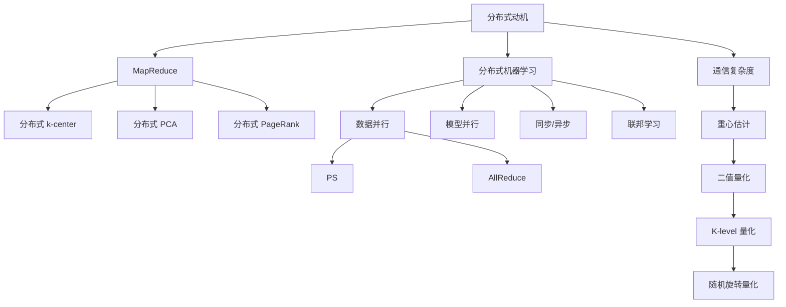
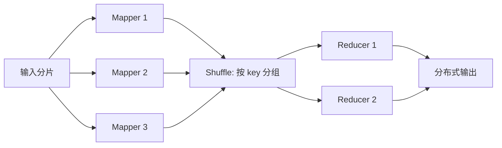
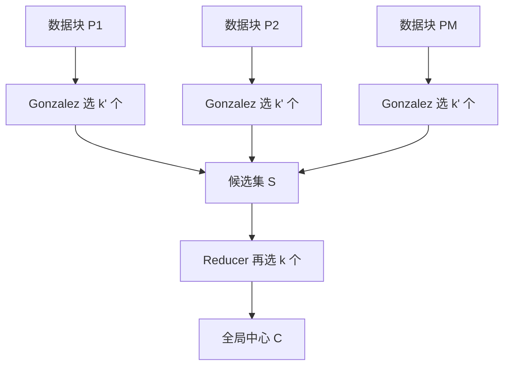

# 第九章 分布式算法

> [!abstract] 本章主线
> 分布式算法并不只是把单机程序复制到多台机器。真正的设计问题是：**如何在计算并行化的同时，尽量减少跨机器通信、同步等待与容错成本。**
> 
> 本章前半讨论系统与经典任务，后半以分布式重心估计为例，展示如何用随机量化在通信量和统计误差之间做可证明的权衡。

## 本章学习目标

1. 区分计算复杂度、通信复杂度和通信轮数；
2. 掌握 MapReduce 的 Map–Shuffle–Reduce 数据流；
3. 推导两轮分布式 $k$-center 的 4-近似保证；
4. 理解分布式 PCA 与 PageRank 的局部计算/全局聚合模式；
5. 区分数据并行、模型并行、参数服务器和 AllReduce；
6. 比较同步、异步训练及其慢节点/梯度陈旧问题；
7. 理解联邦学习与普通分布式训练的区别；
8. 推导随机二值量化的无偏性、均方误差和通信量；
9. 理解多级量化与随机旋转如何改善误差。

## 知识结构图



---

## 9.1 为什么需要分布式算法

### 9.1.1 三类单机瓶颈

1. **计算瓶颈**：单核频率增长放缓，继续提高频率会导致功耗和散热急剧上升；
2. **存储与 I/O 瓶颈**：数据规模超过单机内存和磁盘容量，且 CPU 与内存带宽增速不匹配；
3. **扩展瓶颈**：纵向扩展（scale-up）昂贵且有上限，横向扩展（scale-out）可通过更多机器增加容量。

### 9.1.2 通信复杂度

通信复杂度衡量节点之间传输的数据总量，常以 bit、word、向量元素数表示。还需关注：

- **轮数（round complexity）**：需要多少次全局同步；
- **延迟**：小消息频繁发送可能比少量大消息更慢；
- **带宽**：单位时间可传输的数据量；
- **拓扑**：中心化、环形、树形或全连接；
- **负载均衡**：最慢节点决定同步系统速度。

> [!important] 分布式算法的基本权衡
> 多做本地计算常能减少通信；多传信息可能减少迭代轮数。最优设计依赖计算/通信速度比，而不仅是渐近计算量。

---

## 9.2 MapReduce 模型

### 9.2.1 数据流



1. **Split**：输入划分为多个数据块；
2. **Map**：每个节点产生 $(key,value)$；
3. **Shuffle**：同一 key 的记录跨网络汇聚；
4. **Reduce**：对同 key 的 values 聚合；
5. **Output**：写回分布式文件系统。

### 9.2.2 Word Count

Mapper 对每个词输出

$$
(\text{word},1).
$$

Shuffle 把同一词的所有 1 送到同一 Reducer，Reducer 求和得到总频数。

### 9.2.3 局限性

传统 MapReduce 的中间结果经常落盘，适合批处理但不适合多轮迭代。机器学习和图算法通常需要 Spark、Flink 或专用参数通信框架来减少磁盘 I/O。

---

## 9.3 分布式 $k$-center

### 9.3.1 问题定义

给定点集 $P$，选择 $k$ 个中心 $C$，最小化最大服务距离：

$$
\operatorname{cost}(P,C)
=\max_{p\in P}d(p,C),
\qquad
d(p,C)=\min_{c\in C}d(p,c).
$$

最优半径为

$$
\operatorname{OPT}_k(P)
=\min_{|C|=k}\max_{p\in P}d(p,C).
$$

### 9.3.2 Gonzalez 最远点算法

```text
任选一个点作为第一个中心
重复直到有 k 个中心：
    选择到当前中心集合距离最大的点
返回中心集合
```

时间复杂度为 $O(nk)$，它是 2-近似。

#### 2-近似直觉

算法选出的中心两两距离至少为最终半径 $R_G$。若 $R_G>2R^*$，则任意两个已选中心不可能属于同一个最优半径为 $R^*$ 的簇，因为同簇两点距离至多 $2R^*$。但算法选了 $k+1$ 个“彼此很远”的点时，只能放进 $k$ 个最优簇，抽屉原理产生矛盾。

### 9.3.3 两轮分布式算法

数据划分为 $P_1,\dots,P_M$。

1. 每个 Mapper 在本地 $P_j$ 上用 Gonzalez 选 $k'\ge k$ 个候选中心 $S_j$；
2. Shuffle 把所有 $S_j$ 汇总；
3. Reducer 在
   $$
   S=\bigcup_{j=1}^MS_j
   $$
   上再用 Gonzalez 选最终 $k$ 个中心 $C$。



### 9.3.4 复杂度

若各块大小约 $n/M$：

- Map 并行时间：
  $$
  O\!\left(\frac nM k'\right);
  $$
- 通信量：发送 $Mk'$ 个候选点；若每点维度为 $d$，则为 $O(Mk'd)$ 个数；
- Reduce 时间：
  $$
  O(Mk'k).
  $$

当 $k'=\Theta(k)$ 且 $n\gg Mk$ 时，Map 阶段近似获得 $M$ 倍加速。

### 9.3.5 4-近似定理

> [!theorem] 两轮算法的近似保证
> 若两个阶段都使用 Gonzalez，且 $k'\ge k$，则
> $$
> \max_{p\in P}d(p,C)
> \le4\operatorname{OPT}_k(P).
> $$

#### 详细证明

令

$$
R^*=\operatorname{OPT}_k(P).
$$

对任意本地块 $P_j\subseteq P$：

$$
\operatorname{OPT}_k(P_j)\le R^*.
$$

因为允许 $k'\ge k$ 个中心，

$$
\operatorname{OPT}_{k'}(P_j)
\le\operatorname{OPT}_k(P_j)
\le R^*.
$$

本地 Gonzalez 是 2-近似，所以对每个 $p\in P_j$，存在 $s(p)\in S_j$，满足

$$
d(p,s(p))\le2R^*.
$$

现在看候选集 $S\subseteq P$。原问题的最优 $k$ 个中心也可服务 $S$，因此

$$
\operatorname{OPT}_k(S)
\le R^*.
$$

Reducer 上 Gonzalez 再给出

$$
\max_{s\in S}d(s,C)
\le2R^*.
$$

对任意原始点 $p$，由三角不等式：

$$
\begin{aligned}
d(p,C)
&\le d(p,s(p))+d(s(p),C)\\
&\le2R^*+2R^*=4R^*.
\end{aligned}
$$

证毕。

> [!note] 近似因子的来源
> 一个 2 来自“原始点到局部代表”，另一个 2 来自“局部代表到全局中心”，最终通过三角不等式相加成 4。

---

## 9.4 分布式 PCA 与 PageRank

### 9.4.1 分布式 PCA

若数据已中心化，整体协方差矩阵可写为各节点局部矩阵之和：

$$
X^\top X=\sum_{j=1}^M X_j^\top X_j.
$$

基本流程：

1. 节点计算局部 $X_j^\top X_j$；
2. 上传并求和得到全局协方差；
3. 中心节点做特征分解；
4. 广播前 $k$ 个主成分。

直接上传 $d\times d$ 协方差在高维时仍很昂贵，因此可上传局部低秩近似、随机 sketch 或局部主成分。

### 9.4.2 分布式 PageRank

PageRank 更新可写为

$$
r^{(t+1)}(v)
=\frac{1-\alpha}{n}
+\alpha\sum_{(u,v)\in E}
\frac{r^{(t)}(u)}{d^+(u)}.
$$

Mapper 对每条出边 $(u,v)$ 发出

$$
\left(v,\frac{r^{(t)}(u)}{d^+(u)}\right),
$$

Reducer 按目标网页 $v$ 求和并加入随机跳转项。

通信量与跨机器边数密切相关，因此图分区的目标之一是减少跨分区边。

> [!warning] 悬挂节点
> 若 $d^+(u)=0$，不能直接除以 0。通常把悬挂节点质量均匀分配到所有节点，或并入随机跳转项。

---

## 9.5 分布式机器学习训练

### 9.5.1 数据并行与模型并行

| 方式 | 每个节点存什么 | 每个节点处理什么 | 主要通信 |
|---|---|---|---|
| 数据并行 | 完整模型副本 | 不同 mini-batch | 梯度或参数 |
| 模型并行 | 模型的一部分 | 同一批数据的不同算子/层 | 激活与梯度 |

实际大模型常组合：数据并行 + 张量并行 + 流水线并行。

### 9.5.2 Parameter Server

Worker 计算梯度并发送到参数服务器，服务器聚合、更新并返回参数。

优点：结构灵活，易支持异步和稀疏更新。

缺点：服务器可能成为带宽和计算瓶颈，且存在中心故障点。

### 9.5.3 AllReduce

每个节点持有完整模型，通过集体通信求梯度和。Ring-AllReduce 把梯度分块，执行 reduce-scatter 与 all-gather，避免单一中心节点。

理想情况下，每个节点传输量约与梯度大小同阶，而不是与节点数线性相乘，但延迟和拓扑仍会影响性能。

### 9.5.4 同步与异步

#### 同步训练

所有 Worker 完成本轮后统一聚合：

$$
w_{t+1}=w_t-\eta\frac1M\sum_{j=1}^Mg_{j,t}.
$$

- 优点：更新语义清晰、收敛分析稳定；
- 缺点：受最慢 Worker（straggler）限制。

#### 异步训练

Worker 使用某个旧参数 $w_{t-\tau}$ 计算梯度并立即上传：

$$
w_{t+1}=w_t-\eta g(w_{t-\tau}).
$$

- 优点：吞吐高，无需全局等待；
- 缺点：梯度陈旧，可能震荡或收敛变慢。

SSP（Stale Synchronous Parallel）允许有限的最大落后步数，在同步和异步之间折中。

---

## 9.6 联邦学习与区块链

### 9.6.1 联邦学习不是普通数据并行

普通分布式训练通常假设：

- 节点在同一受控集群；
- 数据可视为来自同一训练任务；
- 网络稳定，参与率高。

联邦学习则常具有：

- 原始数据不离开客户端；
- 客户端数量大、设备异构、随机掉线；
- 数据非独立同分布（non-IID）；
- 隐私和安全是一级目标。

典型 FedAvg：服务器广播模型，客户端做若干本地 SGD，再上传模型差分，服务器按样本量加权平均。

### 9.6.2 隐私技术

- **差分隐私：**裁剪更新并加噪，限制单个样本对输出的影响；
- **安全聚合/MPC：**服务器只看到总和，不看到单客户端更新；
- **同态加密：**在密文上聚合；
- **Split Learning：**客户端上传中间激活而非原始数据。

> [!warning] “数据不出本地”不等于自动隐私
> 梯度、模型差分和中间激活仍可能泄露信息，必须配合隐私机制和威胁模型分析。

### 9.6.3 区块链的角色

区块链可用于记录更新、审计、智能合约和去中心化共识，但也会引入额外通信、延迟和能耗。它解决的是多方信任与可追溯性，不会自动解决模型投毒或隐私泄露。

---

## 9.7 分布式重心估计

### 9.7.1 问题定义

节点 $i$ 持有向量

$$
x_i\in\mathbb R^d,
$$

目标估计真实均值

$$
\bar X=\frac1n\sum_{i=1}^nx_i.
$$

节点使用编码器 $f_i$ 发送压缩消息，服务器解码为 $\hat x_i$，输出

$$
\widehat{\bar X}
=\frac1n\sum_{i=1}^n\hat x_i.
$$

优化目标是：

- 尽量减少总通信 bit 数；
- 尽量减小
  $$
  \mathbb E\|\widehat{\bar X}-\bar X\|_2^2.
  $$

若每个实数用 $L$ bit，原样传输需要

$$
O(ndL)
$$

bit。

> [!note] 为什么普通 JL 降维不能直接解决
> JL 保持距离，但从低维投影通常无法恢复原始坐标均值。重心估计要求服务器最终得到 $\mathbb R^d$ 中的向量，因此编码必须具有可解码或无偏重构结构。

---

## 9.8 随机二值量化

### 9.8.1 编码规则

对节点 $i$，定义

$$
a_i=\min_jx_i(j),
\qquad
b_i=\max_jx_i(j).
$$

对每个坐标 $x=x_i(j)\in[a_i,b_i]$，随机量化为

$$
Y_i(j)=
\begin{cases}
b_i,&\text{概率 }\dfrac{x-a_i}{b_i-a_i},\\[6pt]
a_i,&\text{概率 }\dfrac{b_i-x}{b_i-a_i}.
\end{cases}
$$

若 $a_i=b_i$，向量为常数，直接发送该常数即可。

每个坐标只需 1 bit 指示取 $a_i$ 或 $b_i$，另发送两个端点。

### 9.8.2 无偏性

$$
\begin{aligned}
\mathbb E[Y_i(j)]
&=b_i\frac{x-a_i}{b_i-a_i}
+a_i\frac{b_i-x}{b_i-a_i}\\
&=x.
\end{aligned}
$$

所以

$$
\mathbb E[Y_i]=x_i,
\qquad
\mathbb E[\widehat{\bar X}]=\bar X.
$$

随机化的目的不是让每个坐标精确，而是让误差在平均意义下不偏。

### 9.8.3 单坐标方差

可直接计算：

$$
\mathbb E[(Y_i(j)-x)^2]
=(b_i-x)(x-a_i).
$$

由 $uv\le(u+v)^2/4$：

$$
(b_i-x)(x-a_i)
\le\frac{(b_i-a_i)^2}{4}.
$$

### 9.8.4 均值估计误差

假设不同节点和坐标的随机量化独立，且每个节点误差均值为 0：

$$
\begin{aligned}
\mathbb E\|\widehat{\bar X}-\bar X\|_2^2
&=\frac1{n^2}\sum_{i=1}^n
\mathbb E\|Y_i-x_i\|_2^2\\
&\le\frac1{n^2}\sum_{i=1}^n
\frac{d(b_i-a_i)^2}{4}.
\end{aligned}
$$

又有

$$
(b_i-a_i)^2
\le2\|x_i\|_2^2,
$$

因为若最大、最小坐标分别为 $b_i,a_i$，则

$$
(b_i-a_i)^2\le2(b_i^2+a_i^2)\le2\|x_i\|_2^2.
$$

因此

$$
\boxed{
\mathbb E\|\widehat{\bar X}-\bar X\|_2^2
\le
\frac{d}{2n^2}
\sum_{i=1}^n\|x_i\|_2^2
}
$$

维度 $d$ 很大时，该界较粗。

### 9.8.5 通信量

每个节点发送：

- $d$ 个二值选择：$d$ bit；
- $a_i,b_i$ 两个实数：$2L$ bit。

总通信：

$$
O\bigl(n(d+2L)\bigr).
$$

与原始 $O(ndL)$ 相比，当 $L$ 较大时可显著节省。

---

## 9.9 随机 $K$ 级量化

### 9.9.1 量化网格

把 $[a_i,b_i]$ 划分为 $K-1$ 个等长区间，步长

$$
h_i=\frac{b_i-a_i}{K-1}.
$$

若 $x$ 位于相邻网格点 $\ell$ 与 $u=\ell+h_i$ 之间，则

$$
Y=
\begin{cases}
u,&\text{概率 }\dfrac{x-\ell}{h_i},\\[6pt]
\ell,&\text{概率 }\dfrac{u-x}{h_i}.
\end{cases}
$$

仍有 $\mathbb E[Y]=x$。

### 9.9.2 误差改善

单坐标方差至多

$$
\frac{h_i^2}{4}
=\frac{(b_i-a_i)^2}{4(K-1)^2}.
$$

因此

$$
\mathbb E\|\widehat{\bar X}-\bar X\|_2^2
\le
\frac{d}{2n^2(K-1)^2}
\sum_i\|x_i\|_2^2.
$$

讲义以 $K^2$ 表示尺度；严格使用等间隔的 $K$ 个网格点时，分母是 $(K-1)^2$，渐近上等价。

### 9.9.3 通信量

每个坐标需

$$
\lceil\log_2K\rceil
$$

bit，故总通信约为

$$
O\!\left(n\left(d\log K+2L\right)\right).
$$

$K$ 越大，通信更多，量化误差按 $1/K^2$ 下降。

---

## 9.10 随机旋转量化

### 9.10.1 为什么旋转有帮助

二值/多级量化误差依赖坐标范围

$$
b_i-a_i.
$$

若向量能量集中在少数坐标，这个范围很大。随机正交旋转把能量“摊平”到各坐标。典型高概率结论为

$$
\|Rx_i\|_\infty
=O\!\left(
\|x_i\|_2\sqrt{\frac{\log d}{d}}
\right).
$$

于是

$$
\max_j(Rx_i)_j-
\min_j(Rx_i)_j
=O\!\left(
\|x_i\|_2\sqrt{\frac{\log d}{d}}
\right).
$$

把它代入原先的 $d(b_i-a_i)^2$，维度因子 $d$ 被抵消，变为 $O(\log d)$。

### 9.10.2 算法

1. 所有节点和服务器共享随机正交矩阵 $R$；
2. 节点计算 $z_i=Rx_i$；
3. 对 $z_i$ 做随机 $K$ 级量化，得到 $Y_i$；
4. 服务器解码并逆旋转：
   $$
   \hat x_i=R^\top Y_i;
   $$
5. 求均值。

可使用快速 Hadamard 旋转

$$
R=HD,
$$

其中 $D$ 是随机 $\pm1$ 对角矩阵，$H$ 是归一化 Hadamard 矩阵，计算时间约为 $O(d\log d)$。

### 9.10.3 误差尺度

典型界改善为

$$
\boxed{
\mathbb E\|\widehat{\bar X}-\bar X\|_2^2
\le
O\!\left(
\frac{\log d}{n^2(K-1)^2}
\sum_i\|x_i\|_2^2
\right)
}
$$

通信量与普通 $K$ 级量化同阶，因为旋转由共享随机种子决定，无需发送完整矩阵。

> [!warning] 旋转的代价
> 它降低通信误差，但增加本地计算；还要求编码端和解码端严格共享同一个随机旋转。

---

## 三种量化方法对比

| 方法 | 每坐标 bit | MSE 中维度因子 | 额外计算 |
|---|---:|---:|---|
| 二值量化 | 1 | $d$ | $O(d)$ |
| $K$ 级量化 | $\log_2K$ | $d/(K-1)^2$ | $O(d)$ |
| 随机旋转 + $K$ 级 | $\log_2K$ | $O(\log d/(K-1)^2)$ | $O(d\log d)$ 快速旋转 |

---

## 定义与符号速查

| 符号 | 含义 |
|---|---|
| $M$ | Mapper/Worker 数量 |
| $k'$ | 每个 Mapper 输出的局部候选中心数 |
| $R^*$ | 全局最优 $k$-center 半径 |
| $x_i$ | 第 $i$ 个节点的向量/梯度 |
| $\bar X$ | 精确均值 |
| $\widehat{\bar X}$ | 压缩通信后的均值估计 |
| $a_i,b_i$ | 节点向量的最小、最大坐标 |
| $K$ | 量化等级数 |
| $L$ | 表示一个浮点数所需 bit |
| $R$ | 随机正交旋转矩阵（本节量化部分） |

## 易错点

1. 分布式加速不只取决于总计算量，还取决于通信和最慢节点。
2. Shuffle 通常是 MapReduce 中最昂贵的网络阶段。
3. 分布式 $k$-center 的通信量若按 bit 计算，还需乘以点维度和数值精度。
4. $S\subseteq P$ 才能直接说 $\operatorname{OPT}_k(S)\le\operatorname{OPT}_k(P)$。
5. 同步训练中的全局 batch 变大可能改变优化行为，不一定与单机小 batch 完全相同。
6. 联邦学习不自动提供隐私。
7. 随机量化必须按线性插值概率随机向上下端点舍入，才能保持无偏。
8. $K$ 个等级产生 $K-1$ 个区间。
9. 随机旋转不降低消息 bit 数，而是在相同 bit 预算下降低误差。

## 本章总结

> [!summary]
> - 分布式系统中的核心资源往往是通信而不是浮点运算。
> - MapReduce 通过 key 重分组实现局部计算与全局聚合，但不适合高频迭代。
> - 两轮 Gonzalez 的 4-近似由两个 2-近似误差通过三角不等式叠加得到。
> - 数据并行主要通信梯度，模型并行主要通信激活与反向梯度。
> - 同步训练稳定但受慢节点限制；异步训练吞吐高但存在陈旧梯度。
> - 随机量化通过无偏随机舍入把每坐标的实数通信压缩到少量 bit。
> - 多级量化以更多 bit 换取 $1/K^2$ 级误差下降。
> - 随机旋转把坐标能量摊平，使误差中的 $d$ 因子改善为 $O(\log d)$。

---

## 自测题

> [!question] 1. 通信复杂度
> 一个算法总计算量减少了一半，但通信轮数翻倍。它是否一定更快？为什么？

> [!question] 2. MapReduce
> 在 PageRank 中，Shuffle 的 key 应选源网页还是目标网页？为什么？

> [!question] 3. $k$-center
> 两轮算法中，为什么要求 $k'\ge k$？

> [!question] 4. 4-近似
> 写出从任意原始点 $p$ 到最终中心集 $C$ 的两段三角不等式路径。

> [!question] 5. 同步/异步
> 什么是梯度陈旧？为什么学习率越大时它越危险？

> [!question] 6. 二值量化
> 对区间 $[0,10]$ 中的值 $x=3$，随机二值量化为 10 和 0 的概率分别是多少？验证期望。

> [!question] 7. MSE
> 为什么多个节点的零均值独立量化误差求平均后，MSE 中出现 $1/n^2$ 而不是 $1/n$？最终误差为何通常仍按 $1/n$ 下降？

> [!question] 8. 旋转
> 随机旋转为什么不破坏欧氏距离和均值？

## 自测题答案

> [!success]- 1. 答案
> 不一定。若网络延迟和同步成本占主导，翻倍的通信轮数可能抵消甚至超过计算节省。应比较端到端时间，而非只比较算术操作数。

> [!success]- 2. 答案
> 应以目标网页 $v$ 为 key，因为 Reducer 需要汇总所有指向同一目标网页的贡献，计算其新 PageRank。

> [!success]- 3. 答案
> 只有 $k'\ge k$ 时，局部最优 $k'$-center 半径不大于局部 $k$-center 半径，从而不超过全局最优半径 $R^*$，才能得到局部 2 倍覆盖。

> [!success]- 4. 答案
> 先从 $p$ 到其所在块的局部代表 $s(p)$，再从 $s(p)$ 到最终中心集 $C$：
> $$
> d(p,C)\le d(p,s(p))+d(s(p),C)\le2R^*+2R^*.
> $$

> [!success]- 5. 答案
> Worker 用旧参数 $w_{t-\tau}$ 算出的梯度在当前 $w_t$ 上传。学习率大时，一次旧方向更新的步长更大，更容易越过当前下降方向并引起震荡。

> [!success]- 6. 答案
> 量化为 10 的概率为 $3/10$，为 0 的概率为 $7/10$。期望为
> $$
> 10\times0.3+0\times0.7=3.
> $$

> [!success]- 7. 答案
> 均值误差是 $(1/n)\sum e_i$，平方产生系数 $1/n^2$；独立零均值使交叉项期望为 0，只剩 $n$ 个方差项，所以总量通常是 $n/n^2=1/n$ 级。

> [!success]- 8. 答案
> 正交矩阵满足 $R^\top R=I$，故 $\|Rx-Ry\|_2=\|x-y\|_2$。又因线性性，
> $$
> \frac1n\sum_iRx_i=R\bar X,
> $$
> 服务器乘 $R^\top$ 即恢复原坐标系均值。

---

**上一章：**[[8|第八章 最优传输]]　　**下一章：**[[10|第十章 Beyond Worst-Case Analysis 与压缩感知]]
